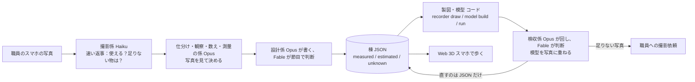

# {{PROJECT_NAME}}（仮名：campus-recorder）

> 下書きです。`{{...}}` は最終日に埋める印です。波かっこの中は本当の値ではありません。

**大学の職員がスマホで建物を撮ると、Claude のエージェントが写真から寸法を測り、設計図を起こし、Blender で組み立て、写真と重ねて確かめ、受験生がスマホで歩ける Web 3D に建物を増やしていきます。**
「写真解析ツール」ではなく、大学が**キャンパスを記録して引き継ぐ仕組み**です。

動画：{{VIDEO_URL}} ・ English: [README.md](README.md)

## 期間中に作った物です

Built with Claude: Japan 2026（2026-11-02 12:00 〜 11-08 20:00 JST）の提出物です。
リポジトリの開始日は **2026-11-02**（最初のコミットの日）。このリポジトリのコード・エージェント定義・文書は、すべて期間中に書きました。
期間前に撮った写真は、公式 Q&A（Q2・Q3）に基づいて「入力データ」として使っています（下の「データと出典」）。
`{{TBD}}`：提出前に Q&A の文言を再確認。

## なぜ作るか

- **遠くの受験生**は、交通費や日数でオープンキャンパスに来られません。360度写真の案内では、建物どうしの距離や坂、駅からの道のりが分かりません。
- **大学の広報担当**は、歩ける3Dを作りたくても、業者に頼む予算も、学内に3Dの専門家もいません。

スキャンや AI 生成との違いは、**生成ではなく記録**であることです。
- 寸法はすべて `measured`（根拠の写真番号つき）、`estimated`（推定。方法と根拠を書く）、`unknown`（値は空）のどれかです。根拠の無い `measured` は検証で落ちます。作り話は入れません。
- 実際の地図の座標（JGD2011 / EPSG:6675）に乗ります。
- 元データは**棟ごとの JSON 1つ**だけ。図面・Blender の模型・写真への重ね合わせは、全部そこから生成します。JSON を直せば作り直せます。
- 写真は公開しません。git には索引だけ入れます。
- 写真が足りないときは、推測せずに頼みます（「図書館の北東面は両端が写っていないので、坂の下から面全体が入る1枚をください」）。

## 仕組み



考え方：**定規はコード、測量士は Claude。** 決まった計算（正面化・周期の検出・描画）はコード（`recorder`）が、判断（どの面か・何スパンか・どの物差しを信じるか・どこを直すか）は Claude のエージェントがして、根拠つきで JSON に書きます。

## Claude の使い方

- **開発の中心は Claude Code。** コード・テスト・文書のほとんどを Claude Code で書きました。
- **係はファイルで定義**（[`.claude/agents/`](.claude/agents/)）：係 8 本と共通の約束（`_共通.md`）。今は Claude Code のサブエージェントとして動かしています。同じ定義を Agent SDK（API）に付け替えて、職員が画面から使える形にする設計です。`{{TBD}}`：提出時点で SDK 側がどこまで動くかを正確に書く。
- **モデルの割り当て**（[`docs/逆算.md`](docs/逆算.md)）：

| 役 | モデル | 仕事 |
|---|---|---|
| 撮影係（`satsuei`） | Haiku | 職員への速い返事 |
| 仕分け・観察・数え・測量（`shiwake` `kansatsu` `kazoe` `sokuryo`） | Opus | 写真を見て決める |
| 設計（`sekkei`）・検収（`kenshu`） | Opus が書いて回し、Fable が節目で判断 | 棟 JSON を書く。模型と写真を比べて JSON を直す |
| 製図・模型（`seizu`） | コード | `recorder draw`、`model build` |
| 実装 | 写真と JSON を見る物は Opus、仕様が明確な物は Sonnet | 道具 |

- **手作業で詰めた手順を、そのまま係の手順書にしました。** 11/3 に最初の2棟を Claude と手で測り、各工程を手順に落としています（[`docs/手順_エージェント.md`](docs/手順_エージェント.md)、12 手順。失敗も記録：写真の角を目で指す方法は誤差が数百 px で失敗したので、視点は正面化から逆算する方法に変えました）。
- 各係は JSON の報告に `made_by`（係とモデル）と `made_at` を残します。
- 使用量は運転規則（`docs/逆算.md`）を決めて見ています。

## 到達点

最終日に埋めます。

| 根拠付きの模型になった棟 | 使った写真 | measured の値 | estimated の値 | unknown の値 | 出した撮影依頼 |
|---|---|---|---|---|---|
| {{N_BUILDINGS}} | {{N_PHOTOS}} | {{N_MEASURED}} | {{N_ESTIMATED}} | {{N_UNKNOWN}} | {{N_REQUESTS}} |

### 試した事と結果（数字つき）

どれも書いてあるコマンドで再現でき、数字の全部は `out/experiments/*.json`（生成物、git 管理外）と各ノートにあります。うまく行かなかった物も残しています。「決めつけない」が売りなので、何が効かなかったかの記録も根拠の一部です。

| 問い | 結果 | ノート |
|---|---|---|
| GPS と方位だけで写真を模型の縁に合わせられるか | **不可。** 本部棟の登録済み 17 枚で合格 0。真の視点が同じ柱割りの格子の中に埋もれる | [`docs/手順_エージェント.md`](docs/手順_エージェント.md)「写真 1 枚ごとの模型合わせ」、`recorder/locate.py` |
| 一括復元（pycolmap、RootSIFT）で重なりの薄い写真を乗せられるか | **不可。** 本部棟 103 枚 → 6 塊・新規 2 枚。タワー75 98 枚 → 6〜7 塊・乗った物 0 | `recorder photos register-sfm`、`out/<棟>/sfm/register_sfm.json` |
| Claude の係が 10×10 の升目で目印 4〜6 点を指し、PnP で解けば、重なりの無い写真でも乗るか | **可。** 真値あり 17 枚で位置の誤差の中央値 0.7 m。タワー75 の本番 32 枚で 14 枚が門を通り、全部重ね画像で目視 | `recorder photos landmarks / pnp`、係 `mejirushi` |
| PoseLib（点＋線）や GeoCalib の重力の事前値は OpenCV の PnP に勝つか | **6 点以上あれば差なし**（3 条件とも中央値 0.41 m）。**GeoCalib は 3 点の時だけ効く**（0.43 m。無しだと最悪 33.5 m）。3 点＋線 2 本なら門を通る。本番のタワー75 では新たに通った写真は無く、1 枚増えた「合格」は目視で偽と分かった。既定は OpenCV のまま | [`docs/実験_登録の3条件_11-06.md`](docs/実験_登録の3条件_11-06.md) |
| 零ショットの窓検出（Grounding DINO）で係の目印探しを肩代わりできるか | **一部。** 本部棟 F1 0.58（視点が怪しい 3 枚を除くと 0.67）、1 枚 1.6 秒。タワー75 は再現率ほぼ 0（窓の列を 1 本の帯と取る）。検出が模型の誤り 2 件を見つけた | [`docs/実験_窓の自動検出_11-06.md`](docs/実験_窓の自動検出_11-06.md) |
| 学習済みの特徴点（ALIKED＋LightGlue）で一括復元の割れは直るか | **塊は減る（タワー75 で 7 → 2）が正しく乗った写真は 0。** 柄の同じ反対側の面を同じ所とつなぎ、合わせが 170〜178° 裏返る。誤った 12 枚を通してしまったので向きの門（30° 以内）を足した | [`docs/実験_一括復元の特徴点_11-06.md`](docs/実験_一括復元の特徴点_11-06.md) |

## セットアップと使い方

必要な物：Python 3.13、Blender 5.2、ネット接続（初回の敷地データ取得と、ビューアが three.js を jsdelivr から読むため）。

```bash
python -m venv .venv
.venv/Scripts/pip install -e ".[dev]"
export BLENDER="<Blender 5.2 の実行ファイルのパス>"   # .blend のダブルクリックでは開かない
```

すべて `python -I -X utf8 -m recorder <コマンド>` で動かします。

| コマンド | 何をするか |
|---|---|
| `new <id> <名前>`（`--from-site`） | 空の棟 JSON（または PLATEAU と5m標高の土台）を作る |
| `validate <json>` | 根拠の決まりを検査 |
| `draw <json>` | 立面図・平面図の SVG（unknown は赤） |
| `unknowns <json>` | unknown の一覧（撮影依頼の元） |
| `model build <json>` | Blender で模型・四面図・鳥瞰・glb（`--cameras` で写真の視点） |
| `run <json>` | 検証→図面→模型→重ね合わせ→`run_report.json` を1回で |
| `site build` / `site export-web` / `site confirm` | 公開データから敷地の土台／ビューア用の書き出し／職員の確認の記録 |
| `photos import` | EXIF を読んで索引に足す（`--period before` または `during`） |
| `photos rectify` / `measure` / `stitch` | 壁を正面に向け直す／柱間隔と階高を数える／片端ずつの2枚をつなぐ |
| `photos compare` / `pose` / `overlay` | 検収：線ごとのずれ（m）／写真の視点の逆算／模型を写真に重ねる |

歩く画面（[`web/README.md`](web/README.md)）：
```bash
python -I -X utf8 -m recorder site export-web
cd web && python -m http.server 8000     # http://localhost:8000/ を開く
```
PC は WASD とドラッグ、スマホは左のスティックで移動・ドラッグで向き。色付きの棟は根拠あり、灰色は未測の PLATEAU の箱です。

テスト：`python -I -X utf8 -m pytest`（`tests/` にあります）。

## データと出典

- **自分で撮った写真**
  - 期間中：2026-11-03 の 124 枚（索引の `period: "during"`）。
  - 期間前：2026-09-07 〜 10-12 の 723 枚（`period: "before"`）。公式 Q&A（Q2・Q3）に基づき**入力データ**として持ち込みました。
  - 写真そのものは**リポジトリに入れません**（公開しない。人の顔・車のナンバーも入れない）。索引 JSON だけ入れます。棟 JSON の根拠は写真の id で指すので、`period` でいつ撮った物かが必ず分かります。
- **期間前に作った自分の分類台帳**（どの写真がどの棟か）を、道具作りの入力に使いました。コードではなくデータです。台帳から来た値は `source: "台帳(期間前)"` と印を付けます。
- **PLATEAU**（国土交通省、名古屋市 2022 版）：建物の足元と高さ。土台にだけ使い、写真の根拠で上書きします。
- **OpenStreetMap**（道・境界・建物名）。`{{TBD}}`：帰属表示の文言（ODbL）。
- **OpenStreetMap の地表の種類**（車道・歩道・芝・駐車場）：歩く画面と模型の地面の塗り分けに estimated として使用（Overpass で 2026-11-05 に 1 回取得。帰属は上と同じ ODbL）。
- **国土地理院**：航空写真と5m標高（出典を表示）。
- **CC0 の素材**（空・光・質感）。`{{TBD}}`：実際に使った物を列挙。
- **CC0 アセット（Poly Haven / Kenney）**：一覧（出典 URL・ライセンス・SHA256）は `data/assets/catalog.json`。CC0-1.0 だけを入れます（CC-BY も入れない）。借りるのは見た目だけで、位置・個数・大きさは棟 JSON の根拠付きの値です。ファイルは `python -m recorder assets fetch` で `assets/` に取ります（リポジトリには入れない）。
- **2026-11-06 に試した公開ライブラリ**（データではなくコードの依存。上の「試した事と結果」参照）：[PoseLib](https://github.com/PoseLib/PoseLib)（BSD-3）、[GeoCalib](https://github.com/cvg/GeoCalib)（Apache-2.0）、[Grounding DINO](https://github.com/IDEA-Research/GroundingDINO)（Hugging Face transformers 経由、Apache-2.0、`grounding-dino-tiny`）、[LightGlue](https://github.com/cvg/LightGlue)（Apache-2.0）＋ALIKED（BSD-3）。学習済みの重みはローカルのキャッシュに落ち、リポジトリには入れていません。SuperPoint・MASt3R/DUSt3R・VGGT の元の重みは非商用や独自の許諾のため使っていません。
- **名城大学の許可（2026-11-04、広報部門）**：公式サイトのキャンパス図・フロアガイドは「トレースして活用」の範囲で使用可、自分で撮った写真の公開可。条件は、研究・研究室に関する物（誰の・どんな研究室・研究内容が分かる写真）を撮らないこと。記録は `data/reference/index.json`。
  - 本作では自主ルールとして、図は建物の名称・有無・大まかな位置の確認にだけ使い、形・寸法は写真と PLATEAU・OSM から起こしています（根拠を写真に置くため）。図そのものはリポジトリに入れていません（`data/reference/` は git 管理外）。

**使わない物**：Google 由来のデータ（地図・航空写真・3D・ストリートビュー）、大学の配置図やネットの図面のなぞり、過去の完成モデル。過去のフォルダは読むだけで、コード・模型・寸法は写していません。

## 正直な限界

- 多くの値は `estimated`（目で見た判断。方法は書いてある）で、測量したわけではありません。測れる根拠がある寸法だけが `measured` です。
- unknown の多い棟は灰色の箱のままで、撮影依頼が出ます。タワー75 の上の角の引っ込み・凹部の深さ・基壇の形・通路橋の高さなどは仮です。
- 本部棟で写真 3 枚で検算したのは南西面だけで、他の面は目で見た推定です。
- 歩く画面に当たり判定はありません。木もまだ。素材と光は最初の版です。
- 検収ができるのは正面化できた面だけです。斜めの写真しか無い面は、まず正面化が要ります。
- 使っていて見つけた道具の不具合は `docs/日誌.md` に残しています。`{{TBD}}`：最終の既知の問題一覧。
- 職員のアップロード画面と Agent SDK 版は `{{TBD}}`：提出時点の状態を書く。

## 謝辞

名城大学（広報部門）に、公式キャンパス図のトレース利用と学内写真の公開について許可をいただきました（2026-11-04）。取り次ぎをいただいた学内の先生にも感謝します。

## ライセンス

`{{LICENSE_TBD}}`：コードは MIT（仮。作者が決める）。データ・画像（棟 JSON・模型・図面・写真）は再利用不可（仮）。`LICENSE` ファイルには今は MIT が入っています。

## 作業日誌

工程ごとの時間は [`docs/日誌.md`](docs/日誌.md) にあります。
