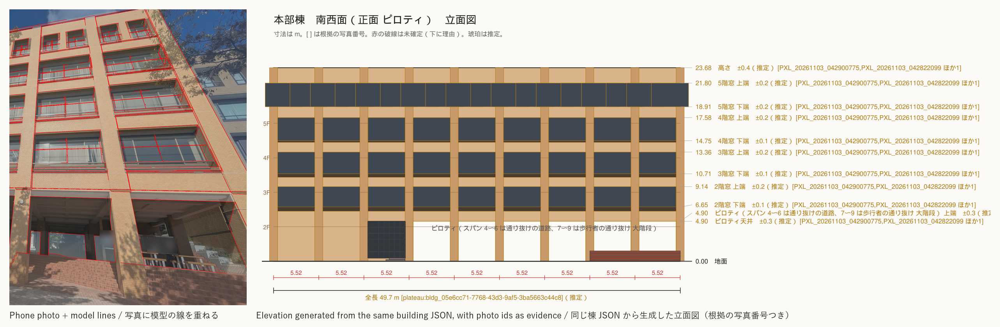
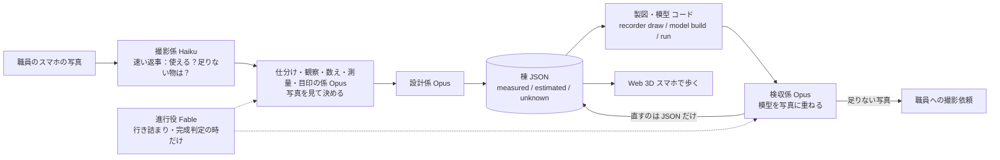
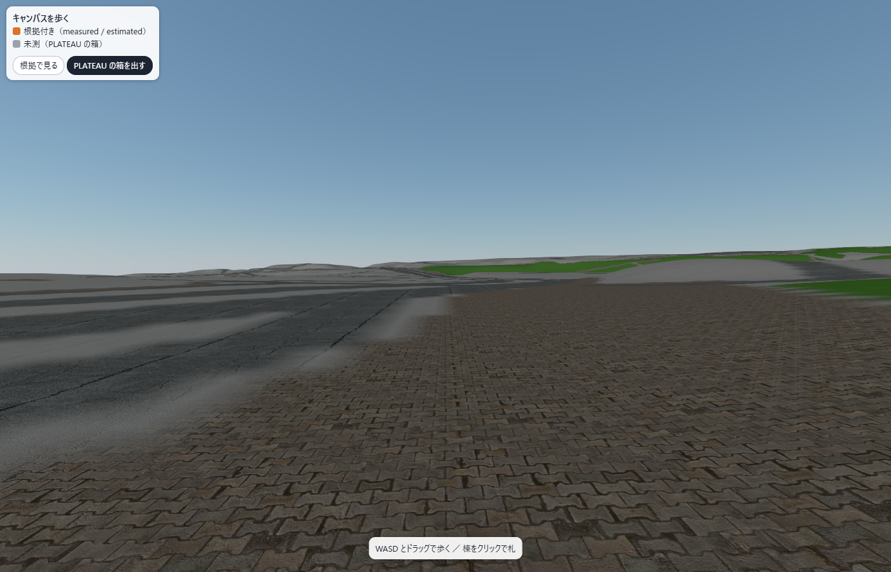
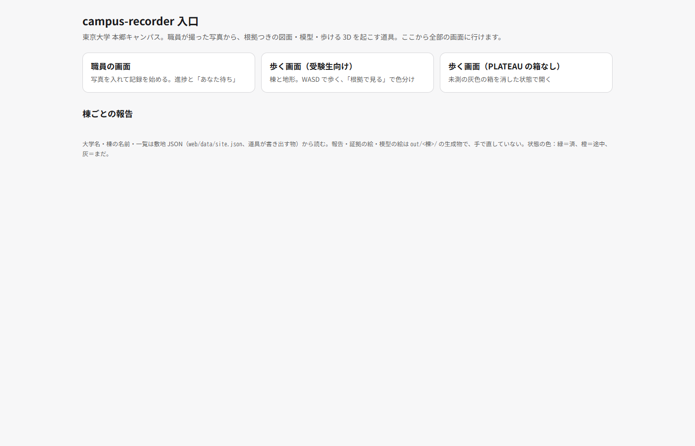

# campus-recorder



**大学の職員がスマホで建物を撮ると、Claude のエージェントが写真を見て判断し（どの棟のどの面か・柱が何本か・どの物差しを信じるか）、計算はコードが行い、棟ごとの設計図（JSON）を起こし、Blender で組み立て、写真と重ねて確かめ、受験生がスマホで歩ける Web 3D に建物を増やしていきます。**
設計図の値には、どこまで信じてよいかの印が付きます。**今の時点では、数（階数・柱間の数）は写真で数えた実測、長さは公開データ（PLATEAU）を物差しにした推定、測れない所は空欄のまま撮影依頼**です。長さを実測にするためのメジャーの写真は 11/7 に撮り、本部棟・図書館・タワー75 は目盛りの読み取りまで済んでいます。共通講義棟南はタイルの周期が読めていません（下の「根拠の無い寸法は書かない」）。
「写真解析ツール」ではなく、大学が**キャンパスを記録して引き継ぐ仕組み**です。

動画：提出時に入れる ・ English: [README.md](README.md)

## 期間中に作った物です

Built with Claude: Japan 2026（2026-11-02 12:00 〜 11-08 20:00 JST）の提出物です。
リポジトリの開始日は **2026-11-02**（最初のコミットの日）。このリポジトリのコード・エージェント定義・文書は、すべて期間中に書きました。
写真も**期間中に撮った物だけ**を使います（経緯は下の「データと出典」）。

前作との対比：作者は前作で同じキャンパスの 3D を **1 人で約 2 か月**（2026-08-20〜10-31）かけて作りました。今回は期間の約 6 日で、期間中に撮った写真 408 枚から 4 棟（本部棟・図書館・タワー75・共通講義棟南）を、値ごとに根拠の印が付いた棟 JSON にします。前作のコード・寸法・座標・模型・画像・写真は使っていません。

## なぜ作るか

- **遠くの受験生**は、交通費や日数でオープンキャンパスに来られません。360度写真の案内では、建物どうしの距離や坂、駅からの道のりが分かりません。
- **大学の広報担当**は、歩ける3Dを作りたくても、業者に頼む予算も、学内に3Dの専門家もいません。

### 根拠の無い寸法は書かない

スキャンや AI 生成との違いは、**生成ではなく記録**であることです。
- 寸法はすべて `measured`（根拠の写真番号つき）、`estimated`（推定。方法と根拠を書く）、`unknown`（値は空）のどれかです。根拠の無い `measured` は検証で落ちます。作り話は入れません。
- **今の measured は全部が数です。** 階数・柱間の数・台数は写真で数えて measured にしています。長さ（柱間・階高・幅）は、PLATEAU の足元の辺か高さを物差しにして写真の px から換算した `estimated` で、長さの measured はまだ 0 件です（棟ごとの数は下の「到達点」の表）。
- **長さを実測にする道：** 11/7 にメジャーを壁のタイルに当てた写真を 68 枚撮って索引に取り込み、測量係が目盛りを読みました。横のタイルの周期は本部棟 11.54 ± 0.14 cm（別の写真での検算 +0.1 %）、図書館 11.54 ± 0.14 cm、タワー75 19.78 ± 0.25 cm。共通講義棟南は横の周期が読めていません（[読みの記録](data/reports/指示_11-08/sokuryo_tape_select.md)）。本部棟と図書館が同じ 11.54 cm なのは写し間違いではありません。別々の写真（本部棟は「本部棟正面柱92cm」の 7 周期、図書館は PXL_20261107_063109753 の 7 周期）で独立に読んだ結果が一致したもので、利用者の申告「同じタイル」の確かめになりました。縦も、同じ正面化画像の中の px の比でタイルの周期から階高へつなげれば、全部の輪が写真で測った物になる（measured の鎖）道ができました。**ただし棟 JSON にはまだ入っていません。** 本部棟の追記を実行した後に反映し、「到達点」の表の「うち長さ」が増えます。それまでは長さは全部 estimated です。
- **測れない所は `unknown` のまま灰色で残し、撮影依頼を返します**（数は「到達点」の表）。例：「図書館の北東面は両端が写っていないので、坂の下から面全体が入る1枚をください」。Claude に審査員役をさせた模擬採点（4 通り × 2 回）で、採点者全員が評価したのがこの点でした。
- 実際の地図の座標（JGD2011 / EPSG:6675）に乗ります。
- 元データは**棟ごとの JSON 1つ**だけ。図面・Blender の模型・写真への重ね合わせは、全部そこから生成します。JSON を直せば作り直せます。
- **写真の扱い**（職員の画面・[`LICENSE-DATA.md`](LICENSE-DATA.md) と同じ決まり）：
  - **本番（大学で使う時）**：公開されるのは歩く画面だけです。写真は職員の PC に留まり、係の Claude（API）が読むためにだけ送られます。職員には、掲示物・顔・ナンバーは写さないようにお願いします。写ってしまった物は、公開版で灰色の箱にします。
  - **この提出物**：研究室が分かる物以外は全部、縮小した公開版（`data/photos/public/`）を入れました。索引 408 枚のうち 407 枚を公開し、1 枚（PXL_20261105_065508197、室内で研究室でないと言い切れない）を安全側で除外しました。灰色の箱を描いた写真は 208 枚で、箱の内訳は掲示物 576・顔 91・ナンバー 22・電話番号 6・人名 4 です（11/8 02:49 の値。`recorder photos publish --dry-run` の集計）。掲示物・人名・顔・ナンバーは、灰色の箱に理由を書いて塗りつぶし、範囲と理由を索引に残します。箱は 3 段で決めました：保護係（Haiku）が 10×10 の升で指す → 見直し（Sonnet）が見落としと自動の顔の箱を確かめる → 寄せ（Sonnet）が細かい升で箱を締める。顔の自動の箱（YuNet）は、見直しで確かめた物だけ描きます。元の写真は git に入れません。

## 仕組み



考え方：**判断は Claude、測るのはコード。** 決まった計算（正面化・周期の検出・視点の計算・描画）はコード（`recorder`）がします。判断（どの面か・何スパンか・どの物差しを信じるか・どこを直すか）は Claude のエージェントがして、根拠つきで JSON に書きます。

**なぜ今の Claude でできるのか：** 画像を見て柱の順番を数える・10×10 の升目で模型の目印を指すといった「見て決める」判断を Claude に任せ、測る計算はコードに分けたので、判断が外れても 2 本目の物差しや再投影の門といったコードの検算で止まる形にできました。

## Claude の使い方

- **開発の中心は Claude Code。** コード・テスト・文書のほとんどを Claude Code で書きました。
- **係はファイルで定義**（[`.claude/agents/`](.claude/agents/)）：係 13 本と共通の約束（`_共通.md`）。今は Claude Code のサブエージェントとして動かしています。同じ定義を `recorder agent`（`recorder/agents.py`、Claude Agent SDK）で API から動かすコードはありますが、**本物の API キーでの通しはまだ一度もしていません**（キーが無い時は送る内容を作るところまでの dry-run）。11/7 の疑似本番もサブエージェント版です。
- **係の一覧とモデル**（各ファイルの `model:` のとおり。運転規則は [`docs/逆算.md`](docs/逆算.md)）：

| 係 | 役割 | モデル |
|---|---|---|
| 撮影係（`satsuei`） | 届いた写真が使えるかを数秒で返し、足りない面・角度を伝える | Haiku |
| 保護係（`hogo`） | 公開用の縮小版で掲示物・人名・顔・ナンバーの升を指す。研究室が分かる写真に公開しない印を付ける（見直しと箱の寄せは Sonnet。公開版 407 枚で回した） | Haiku |
| 地図探し係（`chizu`） | 公式キャンパスマップの URL・日付・棟名を記録する（形はなぞらない） | Haiku |
| 仕分け係（`shiwake`） | 写真がどの棟のどの面かを目視で確定する | Opus |
| 観察係（`kansatsu`） | 面ごとの列数・段数・窓の形などを比率と個数だけで書く（寸法は書かない） | Opus |
| 数え係（`kazoe`） | スパン数と階数を複数の写真で突き合わせて確定する | Opus |
| 測量係（`sokuryo`） | 物差しを選び、正面化→周期→m の換算を道具に走らせ、2 本目の物差しで検算する | Opus |
| 目印係（`mejirushi`） | 写真の中で模型の目印がどの升にあるかを指す（視点は道具が解く） | Opus |
| 設計係（`sekkei`） | 結果を棟 JSON に落とす。写っていない面は仮説か unknown と撮影依頼 | Opus |
| 製図・模型係（`seizu`） | 棟 JSON から図面・模型・glb を出すコードを回す（判断はしない） | Sonnet |
| 検収係（`kenshu`） | 模型と写真のずれを見て、JSON を直して作り直す | Opus |
| 敷地の検収係（`shikichi`） | 棟どうし・棟と地形の食い違いを数字で見て、直す先を言う（自分では直さない） | Opus |
| 進行役（`shinko`） | 行き詰まり・完成判定などの事件の時だけ決め、決めた事を手順書の規則にする | Fable |

- 道具の実装は、写真と JSON を見る物は Opus、仕様が明確な物は Sonnet で書きました。
- **手作業で詰めた手順を、そのまま係の手順書にしました。** 11/3 に最初の2棟を Claude と手で測り、各工程を手順に落としています（[`docs/手順_エージェント.md`](docs/手順_エージェント.md)。失敗も記録：写真の角を目で指す方法は誤差が数百 px で失敗したので、視点は正面化や目印の対応から道具が解く方法に変えました）。
- 各係は JSON の報告に `made_by`（係とモデル）と `made_at` を残します。
- 使用量は運転規則（`docs/逆算.md`）を決めて見ています。
- **Skills・フック・サブエージェント・モデルの使い分け**：サブエージェント（`.claude/agents/*.md` の係 13 本）が中心で、疑似本番では係を 38 回呼びました。モデルは「写真を見て判断する係は Opus、速い返事と升を指すだけの係は Haiku、コードを回すだけの係は Sonnet、事件の時だけ決める進行役は Fable」と分けています。ただし本番の進行役 Fable は疑似本番で使用量が無く、Opus 5.5 が代役でした。**Claude Code の Skills とフックは使っていません**（`.claude/` にあるのは係の定義と `launch.json` だけ）。根拠の無い measured を止めるのはフックではなく、`recorder validate`（検証）とテストです。何も知らない Claude を審査員役にした模擬採点で規則を選んだ事、進行役の決定と詰まりの台帳など、使い方の全体は [`docs/Claude活用の記録.md`](docs/Claude活用の記録.md) にまとめました。

## 到達点

棟ごとの数字は、下の印の間の表だけに書きます（`python -I -X utf8 scripts/readme_numbers.py` が `out/<棟>/report.json` と `recorder counts --json` から書き、README と報告の差が 0 かを照合します）。

<!-- numbers:start -->
**今の値**（2026-11-08 00:26 時点。`out/<棟>/report.json` と `recorder counts --json` から `scripts/readme_numbers.py` が書いた表。手で直さない）

| 棟 | 棟に振り分けた写真 | 視点を解いた写真 | measured（うち長さ） | estimated（うち仮説） | unknown | 独立した観察 measured / estimated / unknown | 撮影依頼 open 職員宛て / 道具宛て | 検収で合格した面 | 再投影の中央値 全体（px / m） | 同 面ごとの最良（px / m） |
|---|---|---|---|---|---|---|---|---|---|---|
| 本部棟 | 121 | 36 | 5（0） | 458（0） | 2 | 5 / 338 / 1 | 11 / 10 | 4（弱い合格 1） | 17.6 px / 0.18 m | 17.1 px / 0.18 m |
| 名城大学付属図書館 | 96 | 45 | 4（0） | 470（4） | 2 | 4 / 285 / 2 | 9 / 7 | 2 | 10.7 px / 0.14 m | 8.2 px / 0.08 m |
| タワー75 | 142 | 89 | 6（0） | 1,294（306） | 2 | 6 / 387 / 1 | 17 / 9 | 6 | 10.5 px / 0.44 m | 9.8 px / 0.41 m |
| 共通講義棟南 | 34 | 18 | 3（0） | 513（78） | 17 | 3 / 222 / 1 | 12 / 11 | 5 | 9.7 px / 0.07 m | 18.4 px / 0.29 m |
| 計 | 393 | 188 | 18（0） | 2,735（388） | 23 | 18 / 1,232 / 5 | 49 / 37 | 17（弱い合格 1） | | |

- 「棟に振り分けた写真」は索引でその棟に振り分けた写真の数（11/7 夜に取り込んだメジャーの写真を含む）。「視点を解いた写真」は登録台帳で視点が解けた数。
- 索引の写真 408 枚と表の計 393 枚の差 15 枚は、敷地（棟と棟の間・地面・通路）に振り分けた 6 枚と、棟を決めていない 9 枚（屋上からの眺め・棟の決まらないメジャーの写真など）です。
- 「measured（うち長さ）」の長さは、写真で直接測った値と、メジャーから測った輪がつながる鎖の値の数（`recorder counts` の direct＋chain）。残りは数（階数・柱間の数・台数）。
- 「独立した観察」は、同じ状態・方法・根拠・値の種類の写しを 1 つに束ねた数。
- 「道具宛て」は職員に撮ってもらう物ではなく、道具（recorder）や係が直す・調べる作業の票。
- 「検収で合格した面」は検収係のまとめ（`data/reports/<棟>/kenshu_summary.json`）で合格の面。合否は**面ごと**に、その面に登録した写真の上で模型の線（柱型の縁・窓の上下・帯）の近く ±0.5 m に写真の縁を探し、見つかった線のずれが全部 0.15 m 以内なら合格（1 枚だけ外れた時は縁の取り違えを先に疑い、他の写真で合っていれば合格、理由を書く）。弱い合格は写真 1 枚・線が少ない合格。
- 再投影の中央値は、目印係が升目で指した点と、解いた視点で模型の目印を写した点のずれ。m は ずれ px × 目印までの距離 ÷ 焦点距離 で直した物。面ごとの最良は点が 3 つ以上の面のうち一番小さい物で、全体と並べて書く。
- **検収の 0.15 m と再投影の中央値は別の物です。** 再投影は視点を解く時に升目で指した点の粗さと、目印の取り違えを含む、写真の位置合わせの目安です。検収は、その視点の上で模型の線と写真の縁を線ごとに比べた差です。再投影の中央値が 0.15 m を超えていても（本部棟・タワー75）、線ごとの差が 0.15 m 以内の面は合格になります。
<!-- numbers:end -->

- **measured は全部が数（階数・柱間の数・台数）で、長さの measured は 0 件です**（表の「うち長さ」）。縮尺は PLATEAU の足元の辺か高さを物差しにした estimated の道を通りました。2 本目の物差し（タイルの段数・PLATEAU の高さ・OSM の辺）との差は 0.1〜5.5 %。タワー75 は OSM の辺と −9〜−14 % 食い違い、未解決のまま残しています。
- **タワー75 の高さは未解決です。** 名前の「75」、PLATEAU の 74.2 m、模型の塔の上端（今は 71.6 m。11/6 の版は 67.88 m）が食い違っています。PLATEAU の 74.2 m が塔のどの部分（パラペット・塔屋・ガラスの冠）を指すのかが写真から決まらないので、模型の高さは estimated のまま、撮影依頼（open）を出してあります。
- 値の数は「部品ごとに書いた数」なので、同じ観察の写しで膨らみます。表の「独立した観察」は写しを束ねた数です（`recorder counts`）。方法が「目視」だけの値は 0 件です。
- 棟の振り分けには、職員が振り分けた物のほかに、取り込みの時に判断役が付けた物と、職員が候補だけ示した写真から仕分け係が選んだ物が混ざっています（内訳は結果.md）。面は全部の写真で仕分け係が決めました。

### 11/7 の疑似本番（08:35〜16:28）

本部棟・図書館・タワー75 は前の結果を退避し（`scripts/trial_reset.py --zero`）、写真と棟の振り分けだけから作り直しました。共通講義棟南は、3 棟で作り込んだ道具と手順を初めて当てた棟です。疑似本番は Claude Code のサブエージェントで回し、進行役は Opus 5.5 が代役を務めました（本番の進行役は Fable）。
**11/7 16:28 の疑似本番の値**（棟ごとの数）は [`data/reports/疑似本番_11-07/結果.md`](data/reports/疑似本番_11-07/結果.md) にあります。その後に写真の取り込みと検収の直しが進んだので、上の表（今の値）とは違います。

- 時間：4 棟を同時に回し、最初の係（08:36）から最後の報告（16:28）まで 7 時間 52 分。うち使用量の上限で約 2 時間 55 分止まりました。係ごとの秒を足すと 16 時間 13 分で、止まった分を除いた経過時間の約 3.3 倍です（同時に回した効き目）。
- トークン（係の結果に出る文脈の大きさを足した目安）：約 1,330 万、1 棟あたり 300〜360 万。費用は本番の API で SDK が出すので、ここには書きません。
- 報告のページの絵（証拠ビューア 3 枚・歩く画面 1 枚、棟ごと）だけは疑似本番の中で撮れませんでした（headless の Edge が開かず：J-030）。生成そのものは全部済んでいて、撮れなかったのは画面を写す工程だけです。疑似本番の後の 21:06〜21:11 に同じ道具をそのまま動かして 4 棟とも撮れました。描いた元は疑似本番の生成物のままで、値は何も変えていません（[結果.md](data/reports/疑似本番_11-07/結果.md)「報告の絵について」）。
- 本番用の直しが 30 件見つかり、23 件が開いています。一番大きいのは、事件の検出が本番の流れを毎棟止めることです（「敷地に置く物」の依頼が語彙の事件になる、検収の後の行き詰まりを線の本数で数える）。一覧は結果.md にあります。

### 別のキャンパスで敷地の土台まで通した試し（11/8 未明）

一時フォルダで試しました。本物の `data/` は触っていません。大学や棟の名前はコードに書いておらず、`campus init` に範囲（bbox）を渡しただけです。

- **名古屋大学 東山キャンパス**：範囲だけを渡して `campus init` → `site build` → `site export-web` が通りました（約 3 分）。
  - OSM のキャンパスの境界（`way/144866408`）は道具が自動で見つけました。
  - 原点は北緯 35.154°・東経 136.9665°、座標は平面直角 VII 系です。OSM の建物は 494 件。
  - PLATEAU のデータは用意しなかったので、建物の高さは unknown の土台です。
  - `recorder new --from-site` で、OSM の輪郭から空の棟 JSON を 1 つ作れることも確かめました（高さは unknown、撮影依頼 11 件）。
- **東京大学 本郷キャンパス**：座標系が IX 系に自動で切り替わりました。
  - 境界は `relation/5414648`、OSM の建物は 162 件。
  - `site export-web` まで通りました（Overpass の混雑で 1 回待ちました）。
- **できたのは敷地の土台（地形・地表・境界・建物の一覧）までです。** 写真は 1 枚も無く、写真から起こした棟もありません。棟を起こすには、その大学の職員の写真が要ります。PLATEAU の無い町では、長さの物差しが OSM の辺だけになります。




### 試した事と結果（数字つき）

どれも書いてあるコマンドで再現でき、数字の全部は `out/experiments/*.json`（生成物、git 管理外）と各ノートにあります。うまく行かなかった物も残しています。「決めつけない」が売りなので、何が効かなかったかの記録も根拠の一部です。

| 問い | 結果 | ノート |
|---|---|---|
| GPS と方位だけで写真を模型の縁に合わせられるか | **不可。** 本部棟の登録済み 17 枚で合格 0。真の視点が同じ柱割りの格子の中に埋もれる | [`docs/手順_エージェント.md`](docs/手順_エージェント.md)「写真 1 枚ごとの模型合わせ」、`recorder/locate.py` |
| 一括復元（pycolmap、RootSIFT）で重なりの薄い写真を乗せられるか | **不可。** 本部棟 103 枚 → 6 塊・新規 2 枚。タワー75 98 枚 → 6〜7 塊・乗った物 0 | `recorder photos register-sfm`、`out/<棟>/sfm/register_sfm.json` |
| Claude の係が 10×10 の升目で目印 4〜6 点を指し、PnP で解けば、重なりの無い写真でも乗るか | **可。** 真値あり 17 枚で位置の誤差の中央値 0.7 m。タワー75 で目印係が試した 32 枚のうち 14 枚が門を通り、全部重ね画像で目視（両棟の登録済みは 18 → 32 枚） | `recorder photos landmarks / pnp`、係 `mejirushi` |
| PoseLib（点＋線）や GeoCalib の重力の事前値は OpenCV の PnP に勝つか | **6 点以上あれば差なし**（3 条件とも中央値 0.41 m）。**GeoCalib は 3 点の時だけ効く**（0.43 m。無しだと最悪 33.5 m）。3 点＋線 2 本なら門を通る。本番のタワー75 では新たに通った写真は無く、1 枚増えた「合格」は目視で偽と分かった。既定は OpenCV のまま | [`docs/実験_登録の3条件_11-06.md`](docs/実験_登録の3条件_11-06.md) |
| 零ショットの窓検出（Grounding DINO）で係の目印探しを肩代わりできるか | **一部。** 本部棟 F1 0.58（視点が怪しい 3 枚を除くと 0.67）、1 枚 1.6 秒。タワー75 は再現率ほぼ 0（窓の列を 1 本の帯と取る）。検出が模型の誤り 2 件を見つけた | [`docs/実験_窓の自動検出_11-06.md`](docs/実験_窓の自動検出_11-06.md) |
| 学習済みの特徴点（ALIKED＋LightGlue）で一括復元の割れは直るか | **塊は減る（タワー75 で 7 → 2）が正しく乗った写真は 0。** 柄の同じ反対側の面を同じ所とつなぎ、合わせが 170〜178° 裏返る。誤った 12 枚を通してしまったので向きの門（30° 以内）を足した | [`docs/実験_一括復元の特徴点_11-06.md`](docs/実験_一括復元の特徴点_11-06.md) |
| 線の目印（帯・窓の列・面の端）で、高さの散らばり不足で落ちた写真は救えるか | **一部。** タワー75 で落ちた 11 枚に Claude の係 2 本が点＋線を指し、道具の合格 8。目視と整合で採ったのは **3 枚**（両棟の登録済みの合計 32 → 35 枚。本部棟 18・タワー75 17）。2 枚は上端の目印だけではカメラの高さが決まらず保留（16 秒差で同じ場所の 3 枚が 1.8／7.2／9.0 m に解けた）、1 枚は E 面の模型を直すまで保留 | [`docs/実験_登録の3条件_11-06.md`](docs/実験_登録の3条件_11-06.md)、`data/photos/registry.json` の `not_registered` |
| 単眼の実寸の深さ（Depth Pro・Depth Anything V2）は第二の物差しになるか | **不可。** Depth Pro は真の距離の 0.43 倍（写真間の散らばり 27 %、遠いほど短い）。DA2-Small は 1.03 倍だが散らばり 54 %。台帳の視点の方が正しいことは柱の幅と塔の高さで確認。写真の中の相対の深さは 10 % 程度でそろうので、隠れた目印探しには使えるかもしれない | [`docs/実験_単眼の深さ_11-06.md`](docs/実験_単眼の深さ_11-06.md) |
| 根拠を「しまう」だけでなく「見せる」ことはできるか | **可。** `recorder evidence` が Rerun の `.rrd` を出す：模型、登録済みの写真を解いた視点に、目印の対応と点ごとの再投影の残差、面ごとの measured／estimated／unknown の件数。デスクトップでも Web のビューアでも開ける | [`docs/実験_証拠ビューア_11-06.md`](docs/実験_証拠ビューア_11-06.md) |
| 写真を貼らずに歩く画面の見た目を上げられるか | **予算内で可。** 敷地の緯度と時刻からの物理的な空、段階的な影、PC では接触影。全部 three.js 付属（MIT）。影の部品を束ねて描画命令 43k → 5.8k。FPS は前 → 後で PC 23.6 → 29.3、スマホ幅 34 → 62（headless の計測、本物のスマホではない）。旧の見た目は `?look=0` | [`docs/実験_歩く画面の見た目_11-06.md`](docs/実験_歩く画面の見た目_11-06.md) |

## セットアップと使い方

必要な物：Python 3.13、Blender 5.2、ネット接続（初回の敷地データ取得と、ビューアが three.js を jsdelivr から読むため）。

```bash
python -m venv .venv
.venv/Scripts/pip install -e ".[dev]"
export BLENDER="<Blender 5.2 の実行ファイルのパス>"   # .blend のダブルクリックでは開かない
```

すべて `python -I -X utf8 -m recorder <コマンド>` で動かします。

| コマンド | 何をするか |
|---|---|
| `new <id> <名前>`（`--from-site`） | 空の棟 JSON（または PLATEAU と5m標高の土台）を作る |
| `validate <json>` | 根拠の決まりを検査 |
| `counts <json>…` | measured／estimated／unknown の値の数と、写しを束ねた独立した観察の数 |
| `draw <json>` | 立面図・平面図の SVG（unknown は赤） |
| `unknowns <json>` | unknown の一覧（撮影依頼の元） |
| `model build <json>` | Blender で模型・四面図・鳥瞰・glb（`--cameras` で写真の視点） |
| `run <json>` | 検証→図面→模型→重ね合わせ→`run_report.json` を1回で |
| `site build` / `site export-web` / `site confirm` | 公開データから敷地の土台／ビューア用の書き出し／職員の確認の記録 |
| `photos import` | EXIF を読んで索引に足す（`--period before` または `during`） |
| `photos rectify` / `measure` / `stitch` | 壁を正面に向け直す／柱間隔と階高を数える／片端ずつの2枚をつなぐ |
| `photos compare` / `pose` / `overlay` | 検収：線ごとのずれ（m）／写真の視点の逆算／模型を写真に重ねる |

歩く画面（[`web/README.md`](web/README.md)）：
```bash
python -I -X utf8 -m recorder site export-web
cd web && python -m http.server 8000     # http://localhost:8000/ を開く
```
入口のページ（職員の画面・報告・歩く画面への入口）は `python -I -X utf8 -m recorder serve --port 8767` で起動して http://localhost:8767/web/hub.html です。
PC は WASD とドラッグ、スマホは左のスティックで移動・ドラッグで向き。色付きの棟は根拠あり、灰色は未測の PLATEAU の箱です。

テスト：`python -I -X utf8 -m pytest`（`tests/` にあります）。

## データと出典

- **自分で撮った写真**（索引 `data/photos/index.json` に 408 枚。すべて期間中）
  - 期間中：2026-11-03〜11-07 の 408 枚（11/3 124・11/4 16・11/5 200・11/7 68（メジャーの写真）。索引の `period: "during"`）。
  - 元の写真は**リポジトリに入れません**。代わりに縮小した公開版（長辺 1600 px、`data/photos/public/<元のフォルダ>/<id>.jpg`、索引の `public_file`）を、研究室が分かる物以外は全部入れました（407 枚、除外 1）。掲示物・人名・電話番号・顔・ナンバーは公開版で灰色の箱＋理由の文字で塗りつぶし（端の掲示物は切り落とし）、範囲と理由を索引の `masks` に残します。ぼかし・モザイク・生成で埋めることはしません。大学の許可の条件（掲示物が分かる画像は不可、顔・ナンバーは公開物から除く）をこの方法で満たすと判断したのは作者で、大学の個別承認ではありません（`data/reference/index.json` の `permission.interpretations`）。棟 JSON の根拠は写真の id で指すので、`period` でいつ撮った物かが必ず分かります。
  - 冒頭の絵（`docs/images/hero.png`）は、期間中に撮った 1 枚への重ね合わせから、人・懸垂幕の写らない範囲を切り出し、扉の貼り紙をぼかした物です。
- **期間前の写真は使っていません（11/7 に外しました）。** 開発の途中（11/4〜11/6）は、期間前（2026-09-07〜10-12）に自分で撮った写真 723 枚と、その時に作った自分の分類台帳（どの写真がどの棟か）を、公式 Q&A（Q2・Q3）に基づいて入力データとして試していました。11/7 に「根拠は期間中の写真だけ」と決め、次のようにしました。
  - 索引・登録台帳・棟 JSON から外しました（11 号館は根拠が期間前の写真だけだったので範囲から外しました）。
  - git の履歴からも記録を除きました。履歴の中で写真の名前があった所は「期間前の写真（削除）」に置き換えています。コミットの日時と文面は変えていません。
  - 3 棟の棟 JSON は 11/7 の疑似本番で、前の版を退避して期間中の写真だけから作り直しました（`scripts/trial_reset.py --zero`）。今の 4 棟の棟 JSON に期間前の写真を根拠にした値はありません（4 棟とも `recorder validate --strict` 警告 0）。
  - `docs/日誌.md` や実験の文書に残る期間前の写真の話は、その時点の作業の記録です。
- **PLATEAU**（国土交通省、名古屋市 2022 版）：建物の足元と高さ。土台にだけ使い、写真の根拠で上書きします。
- **OpenStreetMap**（道・境界・建物名）：© OpenStreetMap contributors。データは Open Database License（ODbL 1.0）で、https://www.openstreetmap.org/copyright に従って表示します。
- **OpenStreetMap の地表の種類**（車道・歩道・芝・駐車場）：歩く画面と模型の地面の塗り分けに estimated として使用（Overpass で 2026-11-05 に 1 回取得。帰属は上と同じ ODbL）。
- **国土地理院**：航空写真と5m標高（出典を表示）。
- **CC0 アセット（Poly Haven / Kenney。空・光・質感・定型の部品）**：一覧（出典 URL・ライセンス・SHA256）は `data/assets/catalog.json`。CC0-1.0 だけを入れます（CC-BY も入れない）。借りるのは見た目だけで、位置・個数・大きさは棟 JSON の根拠付きの値です。ファイルは `python -m recorder assets fetch` で `assets/` に取ります（リポジトリには入れない）。
- **2026-11-06 に試した公開ライブラリ**（データではなくコードの依存。上の「試した事と結果」参照）：[PoseLib](https://github.com/PoseLib/PoseLib)（BSD-3）、[GeoCalib](https://github.com/cvg/GeoCalib)（Apache-2.0）、[Grounding DINO](https://github.com/IDEA-Research/GroundingDINO)（Hugging Face transformers 経由、Apache-2.0、`grounding-dino-tiny`）、[LightGlue](https://github.com/cvg/LightGlue)（Apache-2.0）＋ALIKED（BSD-3）。学習済みの重みはローカルのキャッシュに落ち、リポジトリには入れていません。SuperPoint・MASt3R/DUSt3R・VGGT の元の重みは非商用や独自の許諾のため使っていません。
- **同じ日にほかに試した物**：[Rerun](https://github.com/rerun-io/rerun)（`rerun-sdk`、MIT/Apache-2.0、証拠ビューア）、[Depth Pro](https://github.com/apple/ml-depth-pro)（Apple のサンプルコード許諾。重みはリポジトリに入れない）と [Depth Anything V2 Metric Small](https://huggingface.co/depth-anything/Depth-Anything-V2-Metric-Outdoor-Small-hf)（Apache-2.0、深さの実験）、three.js 付属の `Sky`・`CSM`・`GTAOPass`・`SMAAPass`（MIT、歩く画面）。立面図の PNG 化に [PyMuPDF](https://github.com/pymupdf/PyMuPDF)（AGPL-3.0。冒頭の絵を作る時だけ）。
- **名城大学の許可（2026-11-04、広報部門）**：公式サイトのキャンパス図・フロアガイドは「トレースして活用」の範囲で使用可、自分で撮った写真の公開可。条件は、研究・研究室に関する物（誰の・どんな研究室・研究内容が分かる写真）を撮らないこと。記録は `data/reference/index.json`。
  - 本作では自主ルールとして、図は建物の名称・有無・大まかな位置の確認にだけ使い、形・寸法は写真と PLATEAU・OSM から起こしています（根拠を写真に置くため）。図そのものはリポジトリに入れていません（`data/reference/` は git 管理外）。

**使わない物**：Google 由来のデータ（地図・航空写真・3D・ストリートビュー）、大学の配置図やネットの図面のなぞり、過去の完成モデル。過去のフォルダは読むだけで、コード・模型・寸法は写していません。

## 正直な限界

- 多くの値は `estimated`（写真の px と物差しからの換算、比率、目で見た判断。方法は書いてある）で、測量したわけではありません。測れる根拠がある寸法だけが `measured` です。今の measured は全部が数（階数・柱間の数・台数）で、件数は「到達点」の表にあります。メジャーの写真は 11/7 に撮って目盛りまで読みましたが、棟 JSON に反映するまでは長さは全部 estimated です。
- unknown の面は灰色、仮説の面は縞のままで、撮影依頼が出ます。タワー75 の北・南の面と四隅の多くは仮説（同じ塊・対称から）、図書館 f2 の庇の出と f3 の中ほど、本部棟 f5 の翼の境、共通講義棟南の中庭の面と写真の無い 4 面は撮影待ちです。
- 再検収（模型の線と写真の縁のずれ 0.15 m 以内）で合格した面の数は「到達点」の表にあります（検収係のまとめ `data/reports/<棟>/kenshu_summary.json` から数える）。ほかの面は写真 1〜2 枚からの推定か、登録の直し・撮影待ちです。
- 歩く画面に当たり判定はありません。木もまだ。素材と光は最初の版です。
- 検収ができるのは正面化できた面だけです。斜めの写真しか無い面は、まず正面化が要ります。
- 使っていて見つけた道具の不具合は `docs/日誌.md` に、疑似本番で見つかった本番用の直し（詰まり）は [`data/reports/疑似本番_11-07/結果.md`](data/reports/疑似本番_11-07/結果.md) の一覧に残しています。
- 職員のアップロード画面（`recorder serve` と `web/staff.html`）は、写真を受け取って係の順番を組むところまで動きます。係を API（Agent SDK）で動かす通しは、本物の API キーではまだ一度もしていません（キーが無い時は送る内容を作るところまでの dry-run）。今までの係は全部、作者が Claude Code のサブエージェントとして回しました。

## 謝辞

名城大学（広報部門）に、公式キャンパス図のトレース利用と学内写真の公開について許可をいただきました（2026-11-04）。取り次ぎをいただいた学内の先生にも感謝します。

## ライセンス

- **コード**（`recorder/`・`web/`・`scripts/`・`tests/`、`docs/` のコード部分）：MIT License（[`LICENSE`](LICENSE)）。
- **写真・棟 JSON・敷地 JSON・生成物**（図面・模型・絵・報告）：MIT ではありません。[`LICENSE-DATA.md`](LICENSE-DATA.md) の条件に従います。条件は次のとおりです。
  - 名城大学の許可（2026-11-04）を得て公開しています。
  - 再利用する時は、研究・研究室が分かる物、掲示物、顔、ナンバーを含めないでください。
  - 商用利用・転載は別途ご相談ください。
  - 公開データの部分は、それぞれの出典の条件に従います。
- 外部のライブラリと CC0 アセットは、それぞれの元のライセンスに従います。

## 作業日誌

工程ごとの時間は [`docs/日誌.md`](docs/日誌.md) にあります。
Claude に審査員役をさせて直した記録は [`docs/過程/`](docs/過程/) にあります。
