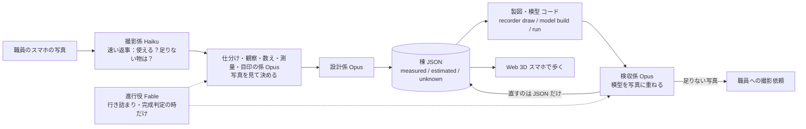

# campus-recorder


**大学の職員がスマホで建物を撮ると、Claude のエージェントが写真を見て判断し（どの棟のどの面か・柱が何本か・どの物差しを信じるか）、寸法の計算はコードが行い、根拠付きの設計図を起こし、Blender で組み立て、写真と重ねて確かめ、受験生がスマホで歩ける Web 3D に建物を増やしていきます。**
「写真解析ツール」ではなく、大学が**キャンパスを記録して引き継ぐ仕組み**です。

動画：{{VIDEO_URL}} ・ English: [README.md](README.md)

## 期間中に作った物です

Built with Claude: Japan 2026（2026-11-02 12:00 〜 11-08 20:00 JST）の提出物です。
リポジトリの開始日は **2026-11-02**（最初のコミットの日）。このリポジトリのコード・エージェント定義・文書は、すべて期間中に書きました。
写真も**期間中（11/3〜11/5）に撮った物だけ**を使います。開発の途中（11/4〜11/6）は、期間前に撮った写真も公式 Q&A（Q2・Q3）に基づいて入力に試しましたが、11/7 に使わないと決め、索引と git の履歴から記録を外しました（下の「データと出典」）。
`{{TBD}}`：提出前に Q&A の文言を再確認。

前作との対比：作者は前作で同じキャンパスの 3D を **1 人で約 2 か月**（2026-08-20〜10-31）かけて作りました。今回は期間の約 6 日で、期間中に撮った写真 340 枚から 3 棟（本部棟・図書館・タワー75）を根拠付きの棟 JSON にします。前作のコード・寸法・座標・模型・画像・写真は使っていません。

## なぜ作るか

- **遠くの受験生**は、交通費や日数でオープンキャンパスに来られません。360度写真の案内では、建物どうしの距離や坂、駅からの道のりが分かりません。
- **大学の広報担当**は、歩ける3Dを作りたくても、業者に頼む予算も、学内に3Dの専門家もいません。

### 根拠の無い寸法は書かない

スキャンや AI 生成との違いは、**生成ではなく記録**であることです。
- 寸法はすべて `measured`（根拠の写真番号つき）、`estimated`（推定。方法と根拠を書く）、`unknown`（値は空）のどれかです。根拠の無い `measured` は検証で落ちます。作り話は入れません。
- **測れない所は `unknown` のまま灰色で残し、撮影依頼を返します**（11/6 時点で unknown 44 値、撮影依頼 83 件）。例：「図書館の北東面は両端が写っていないので、坂の下から面全体が入る1枚をください」。Claude に審査員役をさせた模擬採点（4 通り × 2 回）で、採点者全員が評価したのがこの点でした。
- 実際の地図の座標（JGD2011 / EPSG:6675）に乗ります。
- 元データは**棟ごとの JSON 1つ**だけ。図面・Blender の模型・写真への重ね合わせは、全部そこから生成します。JSON を直せば作り直せます。
- 写真は公開しません。git には索引だけ入れます。

## 仕組み



考え方：**判断は Claude、測るのはコード。** 決まった計算（正面化・周期の検出・視点の計算・描画）はコード（`recorder`）がします。判断（どの面か・何スパンか・どの物差しを信じるか・どこを直すか）は Claude のエージェントがして、根拠つきで JSON に書きます。

**なぜ今の Claude でできるのか：** 画像を見て柱の順番を数える・10×10 の升目で模型の目印を指すといった「見て決める」判断を Claude に任せ、測る計算はコードに分けたので、判断が外れても 2 本目の物差しや再投影の門といったコードの検算で止まる形にできました。

## Claude の使い方

- **開発の中心は Claude Code。** コード・テスト・文書のほとんどを Claude Code で書きました。
- **係はファイルで定義**（[`.claude/agents/`](.claude/agents/)）：係 12 本と共通の約束（`_共通.md`）。今は Claude Code のサブエージェントとして動かしています。同じ定義を `recorder agent` で API から動かせる形にしてあります。`{{TBD}}`：提出時点で API 側がどこまで動くかを正確に書く。
- **係の一覧とモデル**（各ファイルの `model:` のとおり。運転規則は [`docs/逆算.md`](docs/逆算.md)）：

| 係 | 役割 | モデル |
|---|---|---|
| 撮影係（`satsuei`） | 届いた写真が使えるかを数秒で返し、足りない面・角度を伝える | Haiku |
| 地図探し係（`chizu`） | 公式キャンパスマップの URL・日付・棟名を記録する（形はなぞらない） | Haiku |
| 仕分け係（`shiwake`） | 写真がどの棟のどの面かを目視で確定する | Opus |
| 観察係（`kansatsu`） | 面ごとの列数・段数・窓の形などを比率と個数だけで書く（寸法は書かない） | Opus |
| 数え係（`kazoe`） | スパン数と階数を複数の写真で突き合わせて確定する | Opus |
| 測量係（`sokuryo`） | 物差しを選び、正面化→周期→m の換算を道具に走らせ、2 本目の物差しで検算する | Opus |
| 目印係（`mejirushi`） | 写真の中で模型の目印がどの升にあるかを指す（視点は道具が解く） | Opus |
| 設計係（`sekkei`） | 結果を棟 JSON に落とす。写っていない面は仮説か unknown と撮影依頼 | Opus |
| 製図・模型係（`seizu`） | 棟 JSON から図面・模型・glb を出すコードを回す（判断はしない） | Sonnet |
| 検収係（`kenshu`） | 模型と写真のずれを見て、JSON を直して作り直す | Opus |
| 敷地の検収係（`shikichi`） | 棟どうし・棟と地形の食い違いを数字で見て、直す先を言う（自分では直さない） | Opus |
| 進行役（`shinko`） | 行き詰まり・完成判定などの事件の時だけ決め、決めた事を手順書の規則にする | Fable |

- 道具の実装は、写真と JSON を見る物は Opus、仕様が明確な物は Sonnet で書きました。
- **手作業で詰めた手順を、そのまま係の手順書にしました。** 11/3 に最初の2棟を Claude と手で測り、各工程を手順に落としています（[`docs/手順_エージェント.md`](docs/手順_エージェント.md)。失敗も記録：写真の角を目で指す方法は誤差が数百 px で失敗したので、視点は正面化や目印の対応から道具が解く方法に変えました）。
- 各係は JSON の報告に `made_by`（係とモデル）と `made_at` を残します。
- 使用量は運転規則（`docs/逆算.md`）を決めて見ています。

## 到達点

**11/6 時点の値（期間前の写真と 11 号館を外す前の数）。11/7 に期間中の写真だけで 3 棟を作り直した後の値に差し替えます。**

| 根拠付きの模型になった棟 | 使った写真 | measured の値 | estimated の値 | unknown の値 | 出した撮影依頼 |
|---|---|---|---|---|---|
| 4（本部棟・タワー75・図書館・11号館。写真からの measured が入っているのは前の 3 棟。11/7 に範囲を 3 棟にした） | 4 棟に振り分けた 444 枚（期間中 286・期間前 158。期間前は 11/7 に外した）。うち視点を解いて模型と重ねた登録済み 35 枚（うち期間前 2） | 18 | 2,420 | 44 | 83（うち未対応 79） |

値の数は「部品ごとに書いた数」なので、同じ観察の写しで膨らみます（帯を階ごと・柱型ごとに置けば、1 回見た帯の見付けが何百回も書かれる）。**写し 2,010 を除いた独立した観察は 472**：個数の実測 11 ／ 独立した換算 213（うち measured の長さ 5）／ 計算・仮定 147 ／ 目視 65 ／ 仮説 13 ／ unknown 23。
束ね方は `python -I -X utf8 -m recorder counts data/buildings/*.json`（同じ状態・方法・根拠・値の種類を 1 つと数える）。換算・計算・目視の分け方は方法の文の語で機械的に分けた目安です。値で数えると目視は 800 あり、estimated の多くは目で見た判断です（下の「正直な限界」）。

### 試した事と結果（数字つき）

どれも書いてあるコマンドで再現でき、数字の全部は `out/experiments/*.json`（生成物、git 管理外）と各ノートにあります。うまく行かなかった物も残しています。「決めつけない」が売りなので、何が効かなかったかの記録も根拠の一部です。

| 問い | 結果 | ノート |
|---|---|---|
| GPS と方位だけで写真を模型の縁に合わせられるか | **不可。** 本部棟の登録済み 17 枚で合格 0。真の視点が同じ柱割りの格子の中に埋もれる | [`docs/手順_エージェント.md`](docs/手順_エージェント.md)「写真 1 枚ごとの模型合わせ」、`recorder/locate.py` |
| 一括復元（pycolmap、RootSIFT）で重なりの薄い写真を乗せられるか | **不可。** 本部棟 103 枚 → 6 塊・新規 2 枚。タワー75 98 枚 → 6〜7 塊・乗った物 0 | `recorder photos register-sfm`、`out/<棟>/sfm/register_sfm.json` |
| Claude の係が 10×10 の升目で目印 4〜6 点を指し、PnP で解けば、重なりの無い写真でも乗るか | **可。** 真値あり 17 枚で位置の誤差の中央値 0.7 m。タワー75 で目印係が試した 32 枚のうち 14 枚が門を通り、全部重ね画像で目視（両棟の登録済みは 18 → 32 枚） | `recorder photos landmarks / pnp`、係 `mejirushi` |
| PoseLib（点＋線）や GeoCalib の重力の事前値は OpenCV の PnP に勝つか | **6 点以上あれば差なし**（3 条件とも中央値 0.41 m）。**GeoCalib は 3 点の時だけ効く**（0.43 m。無しだと最悪 33.5 m）。3 点＋線 2 本なら門を通る。本番のタワー75 では新たに通った写真は無く、1 枚増えた「合格」は目視で偽と分かった。既定は OpenCV のまま | [`docs/実験_登録の3条件_11-06.md`](docs/実験_登録の3条件_11-06.md) |
| 零ショットの窓検出（Grounding DINO）で係の目印探しを肩代わりできるか | **一部。** 本部棟 F1 0.58（視点が怪しい 3 枚を除くと 0.67）、1 枚 1.6 秒。タワー75 は再現率ほぼ 0（窓の列を 1 本の帯と取る）。検出が模型の誤り 2 件を見つけた | [`docs/実験_窓の自動検出_11-06.md`](docs/実験_窓の自動検出_11-06.md) |
| 学習済みの特徴点（ALIKED＋LightGlue）で一括復元の割れは直るか | **塊は減る（タワー75 で 7 → 2）が正しく乗った写真は 0。** 柄の同じ反対側の面を同じ所とつなぎ、合わせが 170〜178° 裏返る。誤った 12 枚を通してしまったので向きの門（30° 以内）を足した | [`docs/実験_一括復元の特徴点_11-06.md`](docs/実験_一括復元の特徴点_11-06.md) |
| 線の目印（帯・窓の列・面の端）で、高さの散らばり不足で落ちた写真は救えるか | **一部。** タワー75 で落ちた 11 枚に Claude の係 2 本が点＋線を指し、道具の合格 8。目視と整合で採ったのは **3 枚**（両棟の登録済みの合計 32 → 35 枚。本部棟 18・タワー75 17）。2 枚は上端の目印だけではカメラの高さが決まらず保留（16 秒差で同じ場所の 3 枚が 1.8／7.2／9.0 m に解けた）、1 枚は E 面の模型を直すまで保留 | [`docs/実験_登録の3条件_11-06.md`](docs/実験_登録の3条件_11-06.md)、`data/photos/registry.json` の `not_registered` |
| 単眼の実寸の深さ（Depth Pro・Depth Anything V2）は第二の物差しになるか | **不可。** Depth Pro は真の距離の 0.43 倍（写真間の散らばり 27 %、遠いほど短い）。DA2-Small は 1.03 倍だが散らばり 54 %。台帳の視点の方が正しいことは柱の幅と塔の高さで確認。写真の中の相対の深さは 10 % 程度でそろうので、隠れた目印探しには使えるかもしれない | [`docs/実験_単眼の深さ_11-06.md`](docs/実験_単眼の深さ_11-06.md) |
| 根拠を「しまう」だけでなく「見せる」ことはできるか | **可。** `recorder evidence` が Rerun の `.rrd` を出す：模型、登録済みの写真を解いた視点に、目印の対応と点ごとの再投影の残差、面ごとの measured／estimated／unknown の件数。デスクトップでも Web のビューアでも開ける | [`docs/実験_証拠ビューア_11-06.md`](docs/実験_証拠ビューア_11-06.md) |
| 写真を貼らずに歩く画面の見た目を上げられるか | **予算内で可。** 敷地の緯度と時刻からの物理的な空、段階的な影、PC では接触影。全部 three.js 付属（MIT）。影の部品を束ねて描画命令 43k → 5.8k。FPS は前 → 後で PC 23.6 → 29.3、スマホ幅 34 → 62（headless の計測、本物のスマホではない）。旧の見た目は `?look=0` | [`docs/実験_歩く画面の見た目_11-06.md`](docs/実験_歩く画面の見た目_11-06.md) |

## セットアップと使い方

必要な物：Python 3.13、Blender 5.2、ネット接続（初回の敷地データ取得と、ビューアが three.js を jsdelivr から読むため）。

```bash
python -m venv .venv
.venv/Scripts/pip install -e ".[dev]"
export BLENDER="<Blender 5.2 の実行ファイルのパス>"   # .blend のダブルクリックでは開かない
```

すべて `python -I -X utf8 -m recorder <コマンド>` で動かします。

| コマンド | 何をするか |
|---|---|
| `new <id> <名前>`（`--from-site`） | 空の棟 JSON（または PLATEAU と5m標高の土台）を作る |
| `validate <json>` | 根拠の決まりを検査 |
| `counts <json>…` | measured／estimated／unknown の値の数と、写しを束ねた独立した観察の数 |
| `draw <json>` | 立面図・平面図の SVG（unknown は赤） |
| `unknowns <json>` | unknown の一覧（撮影依頼の元） |
| `model build <json>` | Blender で模型・四面図・鳥瞰・glb（`--cameras` で写真の視点） |
| `run <json>` | 検証→図面→模型→重ね合わせ→`run_report.json` を1回で |
| `site build` / `site export-web` / `site confirm` | 公開データから敷地の土台／ビューア用の書き出し／職員の確認の記録 |
| `photos import` | EXIF を読んで索引に足す（`--period before` または `during`） |
| `photos rectify` / `measure` / `stitch` | 壁を正面に向け直す／柱間隔と階高を数える／片端ずつの2枚をつなぐ |
| `photos compare` / `pose` / `overlay` | 検収：線ごとのずれ（m）／写真の視点の逆算／模型を写真に重ねる |

歩く画面（[`web/README.md`](web/README.md)）：
```bash
python -I -X utf8 -m recorder site export-web
cd web && python -m http.server 8000     # http://localhost:8000/ を開く
```
PC は WASD とドラッグ、スマホは左のスティックで移動・ドラッグで向き。色付きの棟は根拠あり、灰色は未測の PLATEAU の箱です。

テスト：`python -I -X utf8 -m pytest`（`tests/` にあります）。

## データと出典

- **自分で撮った写真**（索引 `data/photos/index.json` に 340 枚。すべて期間中）
  - 期間中：2026-11-03〜11-05 の 340 枚（11/3 124・11/4 16・11/5 200。索引の `period: "during"`）。
  - 写真そのものは**リポジトリに入れません**（公開しない。人の顔・車のナンバーも入れない）。索引 JSON だけ入れます。棟 JSON の根拠は写真の id で指すので、`period` でいつ撮った物かが必ず分かります。
  - 冒頭の絵（`docs/images/hero.png`）は、期間中に撮った 1 枚への重ね合わせから、人・懸垂幕の写らない範囲を切り出し、扉の貼り紙をぼかした物です。
- **期間前の写真は使っていません（11/7 に外しました）。** 開発の途中（11/4〜11/6）は、期間前（2026-09-07〜10-12）に自分で撮った写真 723 枚と、その時に作った自分の分類台帳（どの写真がどの棟か）を、公式 Q&A（Q2・Q3）に基づいて入力データとして試していました。11/7 に「根拠は期間中の写真だけ」と決め、次のようにしました。
  - 索引・登録台帳・棟 JSON から外しました（11 号館は根拠が期間前の写真だけだったので範囲から外しました）。
  - git の履歴からも記録を除きました。履歴の中で写真の名前があった所は「期間前の写真（削除）」に置き換えています。コミットの日時と文面は変えていません。
  - 3 棟の棟 JSON は 11/7 に期間中の写真だけから作り直します。それまでの本部棟の版には期間前の写真を根拠にした値が残っていて、根拠の名前が「期間前の写真（削除）」になっています（`recorder validate` が索引に無い根拠として警告します）。
  - `docs/日誌.md` や実験の文書に残る期間前の写真の話は、その時点の作業の記録です。
- **PLATEAU**（国土交通省、名古屋市 2022 版）：建物の足元と高さ。土台にだけ使い、写真の根拠で上書きします。
- **OpenStreetMap**（道・境界・建物名）。`{{TBD}}`：帰属表示の文言（ODbL）。
- **OpenStreetMap の地表の種類**（車道・歩道・芝・駐車場）：歩く画面と模型の地面の塗り分けに estimated として使用（Overpass で 2026-11-05 に 1 回取得。帰属は上と同じ ODbL）。
- **国土地理院**：航空写真と5m標高（出典を表示）。
- **CC0 アセット（Poly Haven / Kenney。空・光・質感・定型の部品）**：一覧（出典 URL・ライセンス・SHA256）は `data/assets/catalog.json`。CC0-1.0 だけを入れます（CC-BY も入れない）。借りるのは見た目だけで、位置・個数・大きさは棟 JSON の根拠付きの値です。ファイルは `python -m recorder assets fetch` で `assets/` に取ります（リポジトリには入れない）。
- **2026-11-06 に試した公開ライブラリ**（データではなくコードの依存。上の「試した事と結果」参照）：[PoseLib](https://github.com/PoseLib/PoseLib)（BSD-3）、[GeoCalib](https://github.com/cvg/GeoCalib)（Apache-2.0）、[Grounding DINO](https://github.com/IDEA-Research/GroundingDINO)（Hugging Face transformers 経由、Apache-2.0、`grounding-dino-tiny`）、[LightGlue](https://github.com/cvg/LightGlue)（Apache-2.0）＋ALIKED（BSD-3）。学習済みの重みはローカルのキャッシュに落ち、リポジトリには入れていません。SuperPoint・MASt3R/DUSt3R・VGGT の元の重みは非商用や独自の許諾のため使っていません。
- **同じ日にほかに試した物**：[Rerun](https://github.com/rerun-io/rerun)（`rerun-sdk`、MIT/Apache-2.0、証拠ビューア）、[Depth Pro](https://github.com/apple/ml-depth-pro)（Apple のサンプルコード許諾。重みはリポジトリに入れない）と [Depth Anything V2 Metric Small](https://huggingface.co/depth-anything/Depth-Anything-V2-Metric-Outdoor-Small-hf)（Apache-2.0、深さの実験）、three.js 付属の `Sky`・`CSM`・`GTAOPass`・`SMAAPass`（MIT、歩く画面）。立面図の PNG 化に [PyMuPDF](https://github.com/pymupdf/PyMuPDF)（AGPL-3.0。冒頭の絵を作る時だけ）。
- **名城大学の許可（2026-11-04、広報部門）**：公式サイトのキャンパス図・フロアガイドは「トレースして活用」の範囲で使用可、自分で撮った写真の公開可。条件は、研究・研究室に関する物（誰の・どんな研究室・研究内容が分かる写真）を撮らないこと。記録は `data/reference/index.json`。
  - 本作では自主ルールとして、図は建物の名称・有無・大まかな位置の確認にだけ使い、形・寸法は写真と PLATEAU・OSM から起こしています（根拠を写真に置くため）。図そのものはリポジトリに入れていません（`data/reference/` は git 管理外）。

**使わない物**：Google 由来のデータ（地図・航空写真・3D・ストリートビュー）、大学の配置図やネットの図面のなぞり、過去の完成モデル。過去のフォルダは読むだけで、コード・模型・寸法は写していません。

## 正直な限界

- 多くの値は `estimated`（目で見た判断。方法は書いてある）で、測量したわけではありません。測れる根拠がある寸法だけが `measured` です。写しを除いた独立した観察 472 のうち、目視は 65、計算・仮定は 147 です。
- unknown の多い棟は灰色の箱のままで、撮影依頼が出ます。タワー75 の上の角の引っ込み・凹部の深さ・基壇の形・通路橋の高さなどは仮です。
- 本部棟で写真 3 枚で検算したのは南西面だけで、他の面は目で見た推定です。
- 歩く画面に当たり判定はありません。木もまだ。素材と光は最初の版です。
- 検収ができるのは正面化できた面だけです。斜めの写真しか無い面は、まず正面化が要ります。
- 使っていて見つけた道具の不具合は `docs/日誌.md` に残しています。`{{TBD}}`：最終の既知の問題一覧。
- 職員のアップロード画面と Agent SDK 版は `{{TBD}}`：提出時点の状態を書く。

## 謝辞

名城大学（広報部門）に、公式キャンパス図のトレース利用と学内写真の公開について許可をいただきました（2026-11-04）。取り次ぎをいただいた学内の先生にも感謝します。

## ライセンス

`{{LICENSE_TBD}}`：コードは MIT（仮。作者が決める）。データ・画像（棟 JSON・模型・図面・写真）は再利用不可（仮）。`LICENSE` ファイルには今は MIT が入っています。

## 作業日誌

工程ごとの時間は [`docs/日誌.md`](docs/日誌.md) にあります。
Claude に審査員役をさせて直した記録は [`docs/過程/`](docs/過程/) にあります。
