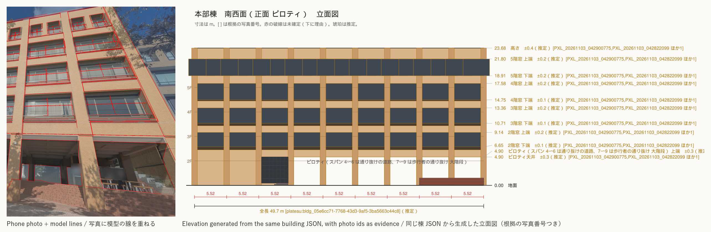
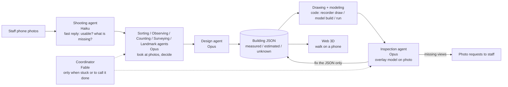

# campus-recorder



**Campus staff take photos with a phone. Claude agents look at the photos and make the judgements (which face of which building, how many columns, which reference length to trust); code does the measuring. The agents then write an evidence-backed design, assemble it in Blender, overlay the model on the photos to check it, and add it to a Web 3D that prospective students can walk on their phones.**
This is a way for a university to *record its campus and hand it over*, not a photo-analysis tool.

Video: {{VIDEO_URL}} · Japanese version: [README.ja.md](README.ja.md)

## Built during the hackathon

This is a submission for Built with Claude: Japan 2026 (2026-11-02 12:00 to 11-08 20:00 JST).
The repository was started on **2026-11-02** (first commit: 2026-11-02). All code, agent definitions, and docs in this repository were written during the event period.
Only **photos taken during the period (11/3 to 11/5)** are used. During development (11/4 to 11/6) we also tried photos taken before the period as input data, as allowed by the official Q&A (Q2, Q3), but on 11/7 we decided not to use them and removed their records from the index and from the git history. See "Data and sources".
`{{TBD}}`: confirm the Q&A wording before submission.

Compared with the previous attempt: the author's earlier 3D model of the same campus took **one person about two months** (2026-08-20 to 10-31). This time, in the roughly six days of the event, 340 photos taken during the period become evidence-backed JSON for 4 buildings (main building, library, Tower 75, Kyotsu Lecture Building South). No code, dimensions, coordinates, models, images, or photos from the earlier work are used.

## Why

- **Prospective students** far from campus cannot afford the trip to open campus. 360-degree photo tours do not show distances between buildings, slopes, or the walk from the station.
- **University PR staff** want a walkable 3D campus but have no budget for a vendor and no 3D expert on staff.

### No dimension without evidence

How this differs from scanning or AI generation: **it records, it does not generate.**
- Every dimension is `measured` (with the ids of the photos it came from), `estimated` (the method and basis are written down), or `unknown` (value is null). A `measured` value with no evidence fails validation. Nothing is invented.
- **What cannot be measured stays `unknown`, shown in gray, and the system returns a photo request** (in the 11/7 dress rehearsal: 23 unknown values, 42 photo requests to staff), e.g. "the library's north-east face needs one photo that shows both ends of the wall, from the bottom of the slope". In a mock judging run (Claude as the judge, 4 rule variants × 2 rounds), this was the one point every judge praised.
- The result sits on real map coordinates (JGD2011 / EPSG:6675), not in a free-floating scene.
- One JSON file per building is the only source of truth. Drawings, the Blender model, and the photo overlays are all generated from it. Fix the JSON and everything is rebuilt.
- All photos except any that would identify a research lab are included as reduced public copies (`data/photos/public/`). Posters, names, faces and license plates are covered with a gray box labelled with the reason, and the box and reason are recorded in the index (policy changed early on 11/8; until then only the index was committed). Original photos are not in git. In production only the walk-through is public; photos stay on the staff PC.

## How it works



Principle: **Claude judges, code measures.** Deterministic tools (`recorder`) rectify photos, find periodic patterns, solve camera poses, and render. Judgement (which face is this, how many bays, which reference length to trust, what to fix) is made by Claude agents and written to JSON with its basis.

**Why this works with today's Claude:** the looking-and-deciding part (counting columns in order across a photo, pointing at model landmarks on a 10×10 grid) is given to Claude and kept separate from the measuring, which stays in code, so when a judgement is wrong the code's checks (a second ruler, reprojection gates) stop it.

## How Claude is used

- **Claude Code is the center of development.** Almost all code, tests, and docs were written with Claude Code.
- **The agents are defined as files** in [`.claude/agents/`](.claude/agents/): twelve agents plus a shared contract (`_共通.md`, "shared promises"). They run as Claude Code subagents now; `recorder agent` runs the same definitions through the API. `{{TBD}}`: state exactly how far the API path works at submission.
- **Agents and models** (as set in each file's `model:`; usage policy in [`docs/逆算.md`](docs/逆算.md)):

| Agent | Role | Model |
|---|---|---|
| Shooting (`satsuei`) | Tells staff within seconds whether a photo is usable and which face or angle is missing | Haiku |
| Map finder (`chizu`) | Records the official campus map's URL, date and building names (never traces shapes) | Haiku |
| Sorting (`shiwake`) | Decides by eye which building and which face a photo shows | Opus |
| Observing (`kansatsu`) | Writes what a face has (columns, rows, window shapes, bands) as ratios and counts only, no dimensions | Opus |
| Counting (`kazoe`) | Fixes the number of bays and floors by cross-checking several photos | Opus |
| Surveying (`sokuryo`) | Picks the reference length, runs rectify → period → metres, and checks with a second ruler | Opus |
| Landmarks (`mejirushi`) | Points to the grid cell where each model landmark appears in a photo; the tool solves the camera | Opus |
| Design (`sekkei`) | Writes the results into the building JSON; unseen faces become hypotheses or `unknown` with a photo request | Opus |
| Drawing and model (`seizu`) | Runs the code that turns the JSON into drawings, the Blender model and glb; makes no judgement | Sonnet |
| Inspection (`kenshu`) | Compares model and photos, fixes the JSON, regenerates | Opus |
| Site inspection (`shikichi`) | Finds mismatches between buildings and with the terrain in numbers and names which JSON to fix (does not fix) | Opus |
| Coordinator (`shinko`) | Called only for incidents (stuck, missing vocabulary, assets, done-or-not); turns each decision into a rule in the procedures | Fable |

- Tools were implemented with Opus when the code has to look at photos or JSON, and Sonnet for clear specs.
- **Hand-made procedures became agent procedures.** On 11/3 the surveying of the first two buildings was done by hand with Claude; each step was then written down as the agents' procedure ([`docs/手順_エージェント.md`](docs/手順_エージェント.md), including the failures: picking photo corners by eye gave hundreds of px of error, so camera poses are now solved by the tool from the rectification or from landmark correspondences).
- Every agent writes a JSON report with `made_by` (agent and model) and `made_at`.
- Usage is monitored with an explicit budget policy (`docs/逆算.md`).

## Results

**Values from the 11/7 dress rehearsal** (summary in Japanese: [`data/reports/疑似本番_11-07/結果.md`](data/reports/疑似本番_11-07/結果.md)).
For the main building, the library and Tower 75, the previous results were set aside (`scripts/trial_reset.py --zero`) and each building was rebuilt from the photos and the building assignments only. Kyotsu Lecture Building South is the first building the tools and procedures built on the other three were applied to.
The rehearsal ran the agents as Claude Code subagents; Opus 5.5 stood in as the coordinator (Fable is the coordinator in the real run).

| Building | Photos assigned to it | Photos with a solved camera | `measured` | `estimated` (of which hypothesis) | `unknown` | Share with a shape | Share with evidence | Open photo requests (to staff / to tools) |
|---|---|---|---|---|---|---|---|---|
| Main building | 88 | 36 | 5 | 458 (0) | 2 | 96.8 % | 1.1 % | 11 / 3 |
| Library | 79 | 45 | 4 | 470 (4) | 2 | 100 % | 0.9 % | 7 / 5 |
| Tower 75 | 131 | 89 | 6 | 1,294 (306) | 2 | 98.7 % | 0.5 % | 12 / 8 |
| Kyotsu Lecture Bldg. South | 29 | 18 | 3 | 513 (78) | 17 | 89.3 % | 0.6 % | 12 / 5 |
| Total | 327 | 188 | 18 | 2,735 (388) | 23 | | | 42 / 21 |

- **All 18 `measured` values are counts (floors, bays, units); there are no `measured` lengths.** None of the four buildings had a photo with a tape measure on the wall, so every scale went the `estimated` way, using a PLATEAU footprint edge or height as the reference length. Against a second ruler (tile courses, PLATEAU height, OSM edge) the difference is 0.1–5.5 %; Tower 75 differs from the OSM edges by −9 to −14 % and is left unresolved. Each building got one photo request for a tape-measure shot.
- "Share with a shape" is the share of faces and parts that are not `unknown`; "share with evidence" is the share of values that are `measured` (procedure doc, "根拠の層"). The shape is almost complete, but only about 1 % of values have `measured` evidence.
- Building assignments come from three sources: staff assignment (Tower 75: 102 photos, Kyotsu South: 29), the building set by the judging agent at intake on 11/3 (main building 61, library 27, Tower 75 29), and photos where staff only gave candidates ("library or main building") and an earlier sorting agent picked one (main building 15, library 52). The last two were not assigned by staff. This run's sorting agents assigned 12 more unassigned photos to the main building, and decided the face of every photo.
- Value counts grow with how finely the model is split. **Excluding 1,521 copies, the independent observations are 18 `measured` / 1,232 `estimated` / 5 `unknown`** (`python -I -X utf8 -m recorder counts data/buildings/*.json`; same status, method, evidence and value kind count as one). No value has "by eye" as its only method.
- Time: the four buildings ran in parallel; 7 h 52 min from the first agent (08:36) to the last report (16:28), including about 2 h 55 min stopped at the usage limit. The agents' times add up to 16 h 13 min, about 3.3 × the elapsed time without the stop.
- Tokens (sum of each agent's final context size, a rough guide): about 13.3 M, 3.0–3.6 M per building. Cost will come from the SDK in the real API run and is not given here.
- The only thing the rehearsal did not produce was the report page's screenshots (3 evidence-viewer images and 1 walk-through image per building): headless Edge failed to open its DevTools port (J-030). Generation itself had finished; only the step that photographs the screen failed. After the rehearsal, at 21:06–21:11, the same tool was run unchanged and all 4 buildings' images were captured. They render the rehearsal's own outputs; no value was changed (see 結果.md, "報告の絵について").
- The rehearsal found 30 fixes for the real run, 23 still open. The largest: incident detection would stop the real pipeline on every building ("put this on the site" requests become vocabulary incidents; "stuck" after inspection is counted in individual lines). The full list is in the summary.

### What we tried, with numbers

Every experiment below is reproducible from the command shown, and the full numbers are in `out/experiments/*.json` (regenerated, not committed) and the linked note. Negative results are kept on purpose: the system's claim is "we do not guess", so the record of what did *not* work is part of the evidence.

| Question | Result | Note |
|---|---|---|
| Can photos be placed by GPS + compass alone, fitting the model edges? | **No.** 0 of 17 reference photos of the main building converged; the true pose is buried in a grid of near-identical column spacings. | [`docs/手順_エージェント.md`](docs/手順_エージェント.md) "写真 1 枚ごとの模型合わせ", `recorder/locate.py` |
| Can bulk SfM (pycolmap, RootSIFT) place photos that have little overlap? | **No.** Main building 103 photos → 6 small clusters, 2 new photos placed. Tower 75 98 photos → 6–7 clusters, 0 anchored. | `recorder photos register-sfm`, `out/<bldg>/sfm/register_sfm.json` |
| Does a Claude agent pointing 4–6 model landmarks on a 10×10 grid, solved by PnP, place a photo with no overlap at all? | **Yes.** Median position error 0.7 m on 17 ground-truth photos. Of the 32 Tower 75 photos the landmark agents tried, 14 passed the gates on the first real run, each checked by eye against an overlay (registered photos, both buildings: 18 → 32). | `recorder photos landmarks / pnp`, agent `mejirushi` |
| Do PoseLib (points+lines) or a GeoCalib gravity prior beat OpenCV PnP? | **Not with 6+ good points** (all three: median 0.41 m). **GeoCalib helps with only 3 points** (0.43 m vs 33.5 m worst case without it), and 3 points + 2 lines pass the gates. On the real tower set no new photo passed; one extra "pass" was a false positive caught by eye. Default stays OpenCV. | [`docs/実験_登録の3条件_11-06.md`](docs/実験_登録の3条件_11-06.md) |
| Can zero-shot window detection (Grounding DINO) replace the agent's landmark search? | **Partly.** Main building F1 0.58 (0.67 after removing 3 photos whose stored pose is itself suspect); 1.6 s per photo. Tower 75: recall ≈ 0 (window columns are read as one strip). Detection also exposed 2 model errors. | [`docs/実験_窓の自動検出_11-06.md`](docs/実験_窓の自動検出_11-06.md) |
| Do learned features (ALIKED + LightGlue) fix the bulk-SfM fragmentation? | **Clusters shrink (7 → 2 on the tower) but 0 new photos are placed correctly.** Identical-looking opposite faces are merged, so the alignment is mirrored by 170–178°. A rotation gate (≤ 30°) was added after it let 12 wrong poses through. | [`docs/実験_一括復元の特徴点_11-06.md`](docs/実験_一括復元の特徴点_11-06.md) |
| Do line landmarks (bands, window rows, face edges) rescue the photos that failed for lack of vertical spread? | **Partly.** On the 11 failed Tower 75 photos, 2 Claude agents pointed points + lines; the solver passed 8. Checking by eye and by consistency kept **3** (registered photos, both buildings: 32 → 35; main building 18, Tower 75 17), 2 are held because the camera height is undetermined from top-edge landmarks alone (three photos taken 16 s apart solved to 1.8 / 7.2 / 9.0 m), 1 is held until the E face model is fixed. | [`docs/実験_登録の3条件_11-06.md`](docs/実験_登録の3条件_11-06.md), `data/photos/registry.json` `not_registered` |
| Can monocular metric depth (Depth Pro, Depth Anything V2) serve as a second ruler? | **No.** Depth Pro reads 0.43× the true distance (spread 27 % between photos, worse with distance); DA2-Small 1.03× but spread 54 %. The stored poses were confirmed correct by column width and tower height. Relative depth within one photo is consistent to ~10 %, so it may help find occluded landmarks later. | [`docs/実験_単眼の深さ_11-06.md`](docs/実験_単眼の深さ_11-06.md) |
| Can the evidence be shown, not just stored? | **Yes.** `recorder evidence` writes a Rerun (`.rrd`) scene: the model, every registered photo at its solved camera, landmark correspondences with per-point reprojection error, and the measured / estimated / unknown counts per face. Opens in the desktop or web viewer. | [`docs/実験_証拠ビューア_11-06.md`](docs/実験_証拠ビューア_11-06.md) |
| Can the walk view look better without textures from photos? | **Yes, within budget.** Physical sky from the site's latitude and time of day, cascaded shadows, contact shadows on PC, all three.js (MIT). Shadow casters merged: 43k → 5.8k draw calls. FPS before → after: PC 23.6 → 29.3, phone-width 34 → 62 (headless, not a real phone). Old look kept at `?look=0`. | [`docs/実験_歩く画面の見た目_11-06.md`](docs/実験_歩く画面の見た目_11-06.md) |

## Setup and usage

Requirements: Python 3.13, Blender 5.2, network access for the first site build and for the viewer (three.js is loaded from jsdelivr).

```bash
python -m venv .venv
.venv/Scripts/pip install -e ".[dev]"
export BLENDER="<path to Blender 5.2 executable>"   # do not open .blend files by double click
```

Run everything as `python -I -X utf8 -m recorder <command>`:

| Command | What it does |
|---|---|
| `new <id> <name>` (`--from-site`) | Create an empty building JSON (or a base from PLATEAU and 5 m elevation) |
| `validate <json>` | Check the evidence rules |
| `counts <json>…` | Count measured / estimated / unknown values, and independent observations with copies grouped |
| `draw <json>` | Elevation and plan SVGs; unknowns shown in red |
| `unknowns <json>` | List unknown values (feeds photo requests) |
| `model build <json>` | Blender model, four views, bird's-eye, glb (`--cameras` for photo viewpoints) |
| `run <json>` | validate, draw, model, overlay, and `run_report.json` in one go |
| `site build` / `site export-web` / `site confirm` | Site base from public data; export for the viewer; record staff confirmation |
| `photos import` | Read EXIF, add to the index (`--period before` or `during`) |
| `photos rectify` / `measure` / `stitch` | Straighten a wall; count bay and floor pitch; join two one-sided photos |
| `photos compare` / `pose` / `overlay` | Inspection: line-by-line offsets in m; recover the camera; overlay model on the photo |

Walk the campus (see [`web/README.md`](web/README.md)):
```bash
python -I -X utf8 -m recorder site export-web
cd web && python -m http.server 8000     # open http://localhost:8000/
```
PC: WASD and drag. Phone: left stick to move, drag to look. Colored buildings have evidence; gray boxes are unmeasured PLATEAU shapes.

Tests: `python -I -X utf8 -m pytest` (test files are in `tests/`).

## Data and sources

- **Photos taken by the author** (340 in the index `data/photos/index.json`, all taken during the period).
  - During the period: 2026-11-03 to 11-05, 340 photos (124 / 16 / 200 per day; index field `period: "during"`).
  - The original photos are **not in this repository**. Instead, reduced public copies (long edge 1600 px, `data/photos/public/<folder>/<id>.jpg`, index field `public_file`) are included for every photo except any that would identify a research lab. Posters, names, phone numbers, faces and license plates are covered in the public copies with a gray box labelled with the reason (posters at the edge may be cropped instead); the boxes and reasons are kept in the index field `masks`. No blurring, pixelation or generative fill. The judgement that this satisfies the university's conditions (no recognisable posters; faces and plates excluded from published material) is the author's, not an individual approval by the university (`data/reference/index.json`, `permission.interpretations`). Evidence in building JSON points to photo ids, so the `period` is always traceable.
  - The image at the top (`docs/images/hero.png`) is cut from an overlay on one photo taken during the period, to a region with no people or hanging banners, with notices on a glass door blurred.
- **Photos taken before the period are not used (removed on 11/7).** During development (11/4 to 11/6) we tried 723 photos the author took before the period (2026-09-07 to 10-12), and the author's own classification ledger made at that time (which photo shows which building), as input data under the official Q&A (Q2, Q3). On 11/7 we decided that evidence comes only from photos taken during the period:
  - They were removed from the photo index, the registration ledger, and the building JSON (Building 11 was dropped from the scope because its only evidence was pre-period photos).
  - Their records were also removed from the git history. Where a photo name appeared in history, it is replaced with "期間前の写真（削除）" ("pre-period photo (removed)"). Commit dates and messages were not changed.
  - In the 11/7 dress rehearsal the 3 building JSON files were set aside and rebuilt from during-period photos only (`scripts/trial_reset.py --zero`). None of the current 4 building JSON files has a value based on a pre-period photo (`recorder validate --strict`: 0 warnings for all 4).
  - Mentions of pre-period photos in `docs/日誌.md` and the experiment notes are records of the work at that time.
- **PLATEAU** (MLIT Japan, Nagoya 2022): building footprints and heights, used only as a base and overwritten by photo evidence.
- **OpenStreetMap** (roads, boundaries, building names). `{{TBD}}`: attribution text (ODbL).
- **OpenStreetMap ground cover** (roads, footways, grass, parking): painted on the walk view and model ground as estimated (fetched once via Overpass, 2026-11-05; same ODbL attribution as above).
- **Geospatial Information Authority of Japan**: aerial photos and 5 m elevation (attribution shown).
- **CC0 assets (Poly Haven / Kenney; sky, lighting, materials, standard parts)**: the full list (source URL, license, SHA256) is in `data/assets/catalog.json`. Only CC0-1.0 is accepted (no CC-BY). They supply only the look; position, count and size come from the evidence-backed values in the building JSON. Files are fetched with `python -m recorder assets fetch` into `assets/` (not in the repository).
- **Open-source libraries tried on 2026-11-06** (code dependencies, not data; see the experiments table): [PoseLib](https://github.com/PoseLib/PoseLib) (BSD-3), [GeoCalib](https://github.com/cvg/GeoCalib) (Apache-2.0), [Grounding DINO](https://github.com/IDEA-Research/GroundingDINO) via Hugging Face transformers (Apache-2.0, `grounding-dino-tiny`), [LightGlue](https://github.com/cvg/LightGlue) (Apache-2.0) with ALIKED (BSD-3). Model weights are downloaded to local caches and are not in the repository. SuperPoint, MASt3R/DUSt3R and the original VGGT weights were not used because of their non-commercial or custom licenses.
- **Also tried on 2026-11-06**: [Rerun](https://github.com/rerun-io/rerun) (`rerun-sdk`, MIT/Apache-2.0) for the evidence viewer; [Depth Pro](https://github.com/apple/ml-depth-pro) (Apple sample-code license; weights kept out of the repository) and [Depth Anything V2 Metric Small](https://huggingface.co/depth-anything/Depth-Anything-V2-Metric-Outdoor-Small-hf) (Apache-2.0) for the depth experiment; three.js `Sky`, `CSM`, `GTAOPass`, `SMAAPass` (MIT) in the walk view. [PyMuPDF](https://github.com/pymupdf/PyMuPDF) (AGPL-3.0) only to rasterize the elevation SVG for the image at the top.
- The official campus map was used only to confirm building names and existence, within the university's permission. No shapes, positions, or dimensions were traced. It is not in the repository (`data/reference/` is git-ignored).

**Not used**: anything derived from Google (maps, aerial photos, 3D, Street View); tracing of any campus plan or web drawing; any previously finished model. Earlier project folders were read-only references; no code, model, or measurement was copied.

## Honest limits

- Many values are `estimated` (converted from photo pixels and a reference length, from ratios, or by eye, with the method written down), not surveyed. Only dimensions with a measurable basis are `measured`. In the 11/7 dress rehearsal, 18 of the 1,255 independent observations are `measured`, and all of them are counts (floors, bays). With no tape-measure photo, every length is `estimated`.
- `unknown` faces stay gray and hypothesis faces striped, with photo requests. Most of Tower 75's north and south faces and corners are hypotheses (same block, symmetry); the library's entrance canopy depth (f2) and the middle of f3, the wing junction on the main building's f5, and Kyotsu South's courtyard faces and four unphotographed faces wait for photos.
- 17 faces across the 4 buildings pass the re-inspection (model lines within 0.15 m of photo edges): main building 4, library 2, Tower 75 6, Kyotsu South 5. The other faces are estimates from one or two photos, or wait for re-registration or new photos.
- No collision detection in the viewer. No trees yet. Materials and lighting are a first pass.
- Inspection works only for faces that could be rectified; oblique-only faces need rectification first.
- Tool bugs found during use are kept in `docs/日誌.md`. `{{TBD}}`: final known-issues list.
- The staff upload screen and the Agent SDK path are `{{TBD}}`: describe the state at submission.

## Acknowledgements

Meijo University (its public relations office) granted permission (2026-11-04) to trace the official campus maps and to publish photos taken on campus, on the condition that nothing related to research or laboratories is photographed. We also thank the faculty member who relayed the request. In this work the maps are used only to confirm building names and rough positions; shapes and dimensions come from photos, PLATEAU and OSM. See `data/reference/index.json`.

## License

`{{LICENSE_TBD}}`: code under MIT (tentative; the author decides). Data and images (building JSON, models, drawings, photos) are not for reuse (tentative). The `LICENSE` file currently contains MIT.

## Work log

Time per step is recorded in [`docs/日誌.md`](docs/日誌.md).
The record of having Claude act as a judge and fixing the work accordingly is in [`docs/過程/`](docs/過程/).
