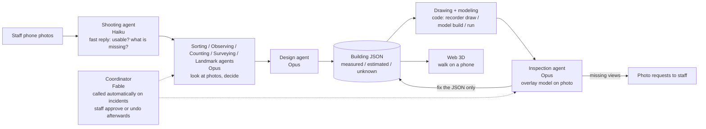

# campus-recorder


**Campus staff take photos with a phone. Claude agents look at the photos and make the judgements (which face of which building, how many columns, which reference length to trust); code does the calculation. The agents then write a design for each building (a JSON file), assemble it in Blender, overlay the model on the photos to check it, and add it to a Web 3D that prospective students can walk on their phones.**
Every value in the design is marked with how far it can be trusted. **Today, counts (floors, bays) are `measured` by counting in photos, most lengths are `estimated` using public data (PLATEAU) as the reference length, and what cannot be measured stays empty with a photo request.** The first `measured` lengths came in the 11/8 real run (the main-building update, with the agents running through the API): the bay width and the parapet height of one face (f6) of the main building, through a chain tape measure → tile period → tiles counted one by one. For the library and Tower 75 the tape has been read but not applied; for Kyotsu South the tile period could not be read (see "No dimension without evidence").
This is a way for a university to *record its campus and hand it over*, not a photo-analysis tool.

Video: to be added at submission · Japanese version: [README.ja.md](README.ja.md)

## Built during the hackathon

This is a submission for Built with Claude: Japan 2026 (2026-11-02 12:00 to 11-08 20:00 JST).
The repository was started on **2026-11-02** (first commit: 2026-11-02). All code, agent definitions, and docs in this repository were written during the event period.
Only **photos taken during the period** are used (the history is in "Data and sources").

Compared with the previous attempt: the author's earlier 3D model of the same campus took **one person about two months** (2026-08-20 to 10-31). This time, in the roughly six days of the event, 408 photos taken during the period become building JSON with an evidence mark on every value, for 4 buildings (main building, library, Tower 75, Kyotsu Lecture Building South). No code, dimensions, coordinates, models, images, or photos from the earlier work are used.

## Why

- **Prospective students** far from campus cannot afford the trip to open campus. 360-degree photo tours do not show distances between buildings, slopes, or the walk from the station.
- **University PR staff** want a walkable 3D campus but have no budget for a vendor and no 3D expert on staff.

### No dimension without evidence

How this differs from scanning or AI generation: **it records, it does not generate.**
- Every dimension is `measured` (with the ids of the photos it came from), `estimated` (the method and basis are written down), or `unknown` (value is null). A `measured` value with no evidence fails validation. Nothing is invented.
- **Almost every `measured` value today is a count.** Floors, bays and units are counted in photos and are `measured`. Most lengths (bay width, floor height, widths) are `estimated`: converted from photo pixels using a PLATEAU footprint edge or height as the reference length. There are only 2 `measured` lengths, both on the main building (next paragraph; per-building numbers are in the "Results" table).
- **The way to measured lengths:** on 11/7, 68 photos with a tape measure held against the wall tiles were taken and imported, and the surveying agent read the scale. Horizontal tile period: main building 11.54 ± 0.14 cm (check on another photo +0.1 %), library 11.54 ± 0.14 cm, Tower 75 19.78 ± 0.25 cm; for Kyotsu South the horizontal period could not be read ([reading notes, Japanese](data/reports/指示_11-08/sokuryo_tape_select.md)). The main building and the library both read 11.54 cm, and this is not a copying error: the two values were read independently from different photos (7 periods on "本部棟正面柱92cm" for the main building, 7 periods on PXL_20261107_063109753 for the library) and agree, which confirms the user's report that the two buildings use the same tile. Vertically, chaining the tile period to the floor height by pixel ratios inside the same rectified image now gives a chain in which every link is measured from photos. **In the 11/8 real run this chain went into the main building's south-south-west face (f6, the main-entrance face)** (values in `data/buildings/honbu.json`).
  - **f6 bay width 5.310 m (`measured`).** The chain: tape measure (photo "本部棟正面柱92cm", 7 tiles from 5.4 to 86.2 cm) → one tile = 0.115429 m → inside the rectified photo of f6 the tile period is uniform (4 places, spread 0.31 %) → 46 tiles from pier centre to pier centre, counted by putting a mark on every joint (on two photos, PXL_20261103_042900775 and PXL_20261103_042909968, both 46). The count is the number of marks, not a division (marks in `data/reports/honbu/sokuryo_count_f6.json`). The error stacked link by link is ± 0.041 m; the building JSON's tolerance is raised to ± 0.054 m, the 1 % floor for a tape-measure ruler.
  - **f6 parapet height 22.66 m (`measured`).** The same chain plus a pixel ratio inside the same rectified photo (ground to parapet ÷ bay). Chain ± 0.21 m, tolerance ± 0.227 m.
  - **Floor height 4.047 m is `estimated`.** The chain measures it to ± 0.044 m, but the building JSON spreads it to the south wing block and the building's floor height, which adds an assumption ("the other faces and blocks are the same"), so it is `estimated` (± 0.17 m). The previous value was 4.13 m (PLATEAU-edge scale): −2.0 %.
  - The face length from the chained bay width is 48.73 ± 0.45 m, −2.0 % from the PLATEAU edge of 49.72 m (inside the ±3 % allowed for PLATEAU). Neither side was forced to match; it stays as an open issue in the building JSON (see "Honest limits").
  - For the library and Tower 75 the tape has been read but not applied to the building JSON; their lengths stay `estimated`.
- **What cannot be measured stays `unknown`, shown in gray, and the system returns a photo request** (numbers in the "Results" table), e.g. "the library's north-east face needs one photo that shows both ends of the wall, from the bottom of the slope". In a mock judging run (Claude as the judge, 4 rule variants × 2 rounds), this was the one point every judge praised.
- The result sits on real map coordinates (JGD2011 / EPSG:6675), not in a free-floating scene.
- One JSON file per building is the only source of truth. Drawings, the Blender model, and the photo overlays are all generated from it. Fix the JSON and everything is rebuilt.
- **How photos are handled** (the same rules as the staff screen and [`LICENSE-DATA.md`](LICENSE-DATA.md)):
  - **In production (at a university):** only the walk-through is public. Photos stay on the staff PC and are sent out only for the agents (Claude, via the API) to read. Staff are asked not to photograph posters, faces or license plates; anything caught anyway is covered with a gray box in the public copy.
  - **In this submission:** reduced public copies (`data/photos/public/`) of all photos except any that would identify a research lab are included. Of the 408 photos in the index, 407 are published and 1 (PXL_20261105_065508197, indoors, cannot be ruled out as a lab) is excluded to be safe. 208 photos carry gray boxes: posters 576, faces 91, license plates 22, phone numbers 6, names 4 (values at 02:49 on 11/8, `recorder photos publish --dry-run`). Posters, names, faces and license plates are covered with a gray box labelled with the reason, and the box and reason are recorded in the index. Boxes are decided in three steps: the privacy agent (Haiku) points at cells on a 10×10 grid → a review (Sonnet) checks for misses and confirms the automatic face boxes → a tightening pass (Sonnet) narrows each box on a finer grid. Automatic face boxes (YuNet) are drawn only when the review confirmed them. Original photos are not in git.

## How it works



Principle: **Claude judges, code measures.** Deterministic tools (`recorder`) rectify photos, find periodic patterns, solve camera poses, and render. Judgement (which face is this, how many bays, which reference length to trust, what to fix) is made by Claude agents and written to JSON with its basis.

**Why this works with today's Claude:** the looking-and-deciding part (counting columns in order across a photo, pointing at model landmarks on a 10×10 grid) is given to Claude and kept separate from the measuring, which stays in code, so when a judgement is wrong the code's checks (a second ruler, reprojection gates) stop it.

## How Claude is used

- **Claude Code is the center of development.** Almost all code, tests, and docs were written with Claude Code.
- **The agents are defined as files** in [`.claude/agents/`](.claude/agents/): thirteen agents plus a shared contract (`_共通.md`, "shared promises"). The same definitions run as Claude Code subagents during development and through the API in the real run (`recorder agent`, `recorder/agents.py`, Claude Agent SDK). The 11/7 dress rehearsal used subagents; **the 11/8 main-building update used the API** (the story is under "Honest limits").
- **Agents and models** (as set in each file's `model:`; usage policy in [`docs/逆算.md`](docs/逆算.md)):

| Agent | Role | Model |
|---|---|---|
| Shooting (`satsuei`) | Tells staff within seconds whether a photo is usable and which face or angle is missing | Haiku |
| Privacy (`hogo`) | Points to grid cells with posters, names, faces or plates on the public copies; marks photos that identify a lab as not public (review and box tightening on Sonnet; run on the 407 public copies) | Haiku |
| Map finder (`chizu`) | Records the official campus map's URL, date and building names (never traces shapes) | Haiku |
| Sorting (`shiwake`) | Decides by eye which building and which face a photo shows | Opus |
| Observing (`kansatsu`) | Writes what a face has (columns, rows, window shapes, bands) as ratios and counts only, no dimensions | Opus |
| Counting (`kazoe`) | Fixes the number of bays and floors by cross-checking several photos | Opus |
| Surveying (`sokuryo`) | Picks the reference length, runs rectify → period → metres, and checks with a second ruler | Opus |
| Landmarks (`mejirushi`) | Points to the grid cell where each model landmark appears in a photo; the tool solves the camera | Opus |
| Design (`sekkei`) | Writes the results into the building JSON; unseen faces become hypotheses or `unknown` with a photo request | Opus |
| Drawing and model (`seizu`) | Runs the code that turns the JSON into drawings, the Blender model and glb; makes no judgement | Sonnet |
| Inspection (`kenshu`) | Compares model and photos, fixes the JSON, regenerates | Opus |
| Site inspection (`shikichi`) | Finds mismatches between buildings and with the terrain in numbers and names which JSON to fix (does not fix) | Opus |
| Coordinator (`shinko`) | Called automatically by the tool only when an incident appears (faces that keep failing re-inspection, issues no rule can settle, …). Reads, writes a decision file, and has the same record redone from a named step (up to 3 times per record; the 4th time a person is called) | Fable |

- **On an incident, the coordinator decides and the run goes on; people review afterwards** (built at midday on 11/8):
  - When an agent step raises an incident, the tool calls the coordinator. It reads the record and reports and writes a decision file (example: [`決定_自動_honbu_1.md`](data/reports/指示_11-08/決定_自動_honbu_1.md), Japanese); the tool then redoes the same record from the named step, following the decision.
  - The staff screen shows the incident, the coordinator's decision, and approve / undo. Undo stops the run before the next step.
  - **The cost limit is set by a person** (default 40 USD per building, a field on the staff screen). If there is not enough left to call the coordinator, the run stops with "please enter a limit", and continues once one is entered.
  - Limits per call: Opus 40 turns and 6 USD (surveying, design and inspection 90 turns), Sonnet 30 turns and 2.5 USD, coordinator (Fable) 40 turns and 10 USD. A step stopped by a limit, a crash or congestion resumes automatically from the same conversation (up to 3 times per step).
- **Pre-flight check before resuming:** `recorder agent preflight <bldg> --call-models` lists the environment (API key, Blender, write access), the record's consistency, incidents and whether the coordinator can be called, the agent definitions, data validation, locks, and whether `serve` is reachable; with `--call-models` it tries each model the agents use with a minimal call. In the 4th round on 11/8 it caught "Invalid API key" on all 4 models before the button was pressed.
- Tools were implemented with Opus when the code has to look at photos or JSON, and Sonnet for clear specs.
- **Hand-made procedures became agent procedures.** On 11/3 the surveying of the first two buildings was done by hand with Claude; each step was then written down as the agents' procedure ([`docs/手順_エージェント.md`](docs/手順_エージェント.md), including the failures: picking photo corners by eye gave hundreds of px of error, so camera poses are now solved by the tool from the rectification or from landmark correspondences).
- Every agent writes a JSON report with `made_by` (agent and model) and `made_at`.
- Usage is monitored with an explicit budget policy (`docs/逆算.md`).
- **Skills, hooks, subagents, and model choice:** subagents (the 13 agents in `.claude/agents/*.md`) are the core; the dress rehearsal called them 38 times. Models are split as: agents that judge photos use Opus, agents that only reply fast or point at grid cells use Haiku, the agent that only runs code uses Sonnet, and the coordinator that decides only on incidents uses Fable. In the dress rehearsal Fable had no usage left and Opus 5.5 stood in as coordinator. In the 11/8 real run, incident 1 was decided by Fable in conversation, and in the 4th round the in-product coordinator (Fable) decided automatically. **Claude Code Skills and hooks are not used** (`.claude/` holds only the agent definitions and `launch.json`). `measured` values without evidence are stopped by `recorder validate` and the tests, not by a hook. The full record of how Claude was used (mock judging by a Claude that knew nothing about the project, the coordinator's decisions and the blocker ledger) is in [`docs/Claude活用の記録.md`](docs/Claude活用の記録.md) (Japanese).

## Results

Per-building numbers appear only in the table between the markers below (`python -I -X utf8 scripts/readme_numbers.py` writes it from `out/<bldg>/report.json` and `recorder counts --json`, and checks that the README and the reports differ by 0).

<!-- numbers:start -->
**Current values** (as of 2026-11-08 12:34; generated by `scripts/readme_numbers.py` from `out/<bldg>/report.json` and `recorder counts --json`; do not edit by hand)

| Building | Photos assigned | Photos with a solved camera | `measured` (of which lengths) | `estimated` (of which hypothesis) | `unknown` | Independent observations m / e / u | Open requests to staff / to tools | Faces passing inspection | Reprojection median, all (px / m) | Same, best face (px / m) |
|---|---|---|---|---|---|---|---|---|---|---|
| Main building | 121 | 42 | 7 (2) | 456 (0) | 2 | 7 / 339 / 1 | 10 / 14 | 1 | 23.1 px / 0.2 m | 18.2 px / 0.27 m |
| Library | 96 | 45 | 4 (0) | 470 (4) | 2 | 4 / 285 / 2 | 9 / 7 | 2 | 10.7 px / 0.14 m | 8.2 px / 0.08 m |
| Tower 75 | 142 | 89 | 6 (0) | 1,294 (306) | 2 | 6 / 387 / 1 | 17 / 9 | 6 | 10.5 px / 0.44 m | 9.8 px / 0.41 m |
| Kyotsu Lecture Bldg. South | 34 | 18 | 3 (0) | 513 (78) | 17 | 3 / 222 / 1 | 12 / 11 | 5 | 9.7 px / 0.07 m | 18.4 px / 0.29 m |
| Total | 393 | 194 | 20 (2) | 2,733 (388) | 23 | 20 / 1,233 / 5 | 48 / 41 | 14 | | |

- "Photos assigned" counts photos assigned to the building in the index (including the tape-measure photos imported on the night of 11/7). "Photos with a solved camera" counts photos whose pose was solved in the registry.
- The difference between the 408 photos in the index and the 393 in the table (15) is 6 photos assigned to the site (between buildings, ground, paths) and 9 photos with no building decided (views from roofs, tape-measure photos whose building is not decided, etc.).
- "Of which lengths" counts `measured` values read directly from a photo or through a chain that ends at a tape measure (`recorder counts`: direct + chain). The rest are counts (floors, bays, units).
- "Independent observations" groups copies with the same status, method, evidence and value kind.
- "To tools" are work tickets for the tool (`recorder`) or the agents, not photo requests to staff.
- "Faces passing inspection" are faces marked as passing in the inspection agent's summary (`data/reports/<bldg>/kenshu_summary.json`). The verdict is **per face**: on the photos registered to that face, the tool searches ±0.5 m around each model line (pier edges, window tops and bottoms, bands) for a photo edge, and the face passes if every found line is within 0.15 m (if one photo alone fails, an edge mix-up is suspected first and the face passes when the other photos agree, with the reason written down). "Weak" passes rest on one photo or few lines.
- Reprojection median: the distance between where a landmark agent pointed on the grid and where the solved camera projects the model landmark. m = px × distance to the landmark ÷ focal length in px. The best face (faces with 3+ points) is shown next to the overall median, never alone.
- **The 0.15 m inspection threshold and the reprojection median are different things.** Reprojection reflects how coarse the grid pointing is when the camera is solved, including landmark mix-ups; it is a guide to photo alignment. Inspection compares, line by line on that camera, the model's lines with the photo's edges. A face can pass (all lines within 0.15 m) even where the reprojection median is above 0.15 m (main building, Tower 75).
<!-- numbers:end -->

- **Almost every `measured` value is a count (floors, bays, units); the `measured` lengths are 2: the bay width and parapet height of the main building's f6** (the "of which lengths" column; a chain from a tape measure). Other lengths went the `estimated` way, using a PLATEAU footprint edge or height as the reference length. Against a second ruler (tile courses, PLATEAU height, OSM edge) the difference is 0.1–5.5 %; Tower 75 differs from the OSM edges by −9 to −14 % and is left unresolved.
- **The height of Tower 75 is unresolved.** The name "75", PLATEAU's 74.2 m and the top of the model's tower (now 71.6 m; 67.88 m in the 11/6 version) disagree. Which part of the tower PLATEAU's 74.2 m refers to (parapet, rooftop structure, glass crown) cannot be decided from the photos, so the model height stays `estimated` and an open photo request has been issued.
- Value counts grow with how finely the model is split. "Independent observations" in the table group the copies (`recorder counts`). No value has "by eye" as its only method.
- Building assignments include, besides staff assignments, buildings set by the judging agent at intake and buildings a sorting agent picked from staff candidates (breakdown in 結果.md). The sorting agents decided the face of every photo.

### The 11/7 dress rehearsal (08:35–16:28)

For the main building, the library and Tower 75, the previous results were set aside (`scripts/trial_reset.py --zero`) and each building was rebuilt from the photos and the building assignments only. Kyotsu Lecture Building South is the first building the tools and procedures built on the other three were applied to. The rehearsal ran the agents as Claude Code subagents; Opus 5.5 stood in as the coordinator (Fable is the coordinator in the real run).
**The values of the 11/7 16:28 dress rehearsal** (per building) are in [`data/reports/疑似本番_11-07/結果.md`](data/reports/疑似本番_11-07/結果.md) (Japanese). Photo intake and inspection fixes continued afterwards, so they differ from the current table above.

- Time: the four buildings ran in parallel; 7 h 52 min from the first agent (08:36) to the last report (16:28), including about 2 h 55 min stopped at the usage limit. The agents' times add up to 16 h 13 min, about 3.3 × the elapsed time without the stop.
- Tokens (sum of each agent's final context size, a rough guide): about 13.3 M, 3.0–3.6 M per building. Cost will come from the SDK in the real API run and is not given here.
- The only thing the rehearsal did not produce was the report page's screenshots (3 evidence-viewer images and 1 walk-through image per building): headless Edge failed to open its DevTools port (J-030). Generation itself had finished; only the step that photographs the screen failed. After the rehearsal, at 21:06–21:11, the same tool was run unchanged and all 4 buildings' images were captured. They render the rehearsal's own outputs; no value was changed (see 結果.md, "報告の絵について").
- The rehearsal found 30 fixes for the real run, 23 still open. The largest: incident detection would stop the real pipeline on every building ("put this on the site" requests become vocabulary incidents; "stuck" after inspection is counted in individual lines). The full list is in the summary.

### Trial on other campuses, up to the site base (early 11/8)

This was run in a temporary folder; the real `data/` was not touched. No university or building names are written in the code: `campus init` was given only an area (bbox).

- **Nagoya University, Higashiyama campus:** given only the area, `campus init` → `site build` → `site export-web` all ran (about 3 min).
  - The tool found the OSM campus boundary (`way/144866408`) by itself.
  - The origin is at 35.154° N, 136.9665° E, in plane rectangular zone VII. OSM lists 494 buildings.
  - No PLATEAU data was prepared, so the base has building heights as `unknown`.
  - `recorder new --from-site` also made an empty building JSON from one OSM outline (height `unknown`, 11 photo requests).
- **University of Tokyo, Hongo campus:** the coordinate system switched to zone IX automatically.
  - The boundary is `relation/5414648`, and OSM lists 162 buildings.
  - `site export-web` also ran (after one wait while Overpass was busy).
- **Only the site base (terrain, ground cover, boundary, building list) was produced.** There are no photos and no building built from photos; that needs photos from the university's own staff. Where there is no PLATEAU, the only reference length is OSM edges.


### What we tried, with numbers

Every experiment below is reproducible from the command shown, and the full numbers are in `out/experiments/*.json` (regenerated, not committed) and the linked note. Negative results are kept on purpose: the system's claim is "we do not guess", so the record of what did *not* work is part of the evidence.

| Question | Result | Note |
|---|---|---|
| Can photos be placed by GPS + compass alone, fitting the model edges? | **No.** 0 of 17 reference photos of the main building converged; the true pose is buried in a grid of near-identical column spacings. | [`docs/手順_エージェント.md`](docs/手順_エージェント.md) "写真 1 枚ごとの模型合わせ", `recorder/locate.py` |
| Can bulk SfM (pycolmap, RootSIFT) place photos that have little overlap? | **No.** Main building 103 photos → 6 small clusters, 2 new photos placed. Tower 75 98 photos → 6–7 clusters, 0 anchored. | `recorder photos register-sfm`, `out/<bldg>/sfm/register_sfm.json` |
| Does a Claude agent pointing 4–6 model landmarks on a 10×10 grid, solved by PnP, place a photo with no overlap at all? | **Yes.** Median position error 0.7 m on 17 ground-truth photos. Of the 32 Tower 75 photos the landmark agents tried, 14 passed the gates on the first real run, each checked by eye against an overlay (registered photos, both buildings: 18 → 32). | `recorder photos landmarks / pnp`, agent `mejirushi` |
| Do PoseLib (points+lines) or a GeoCalib gravity prior beat OpenCV PnP? | **Not with 6+ good points** (all three: median 0.41 m). **GeoCalib helps with only 3 points** (0.43 m vs 33.5 m worst case without it), and 3 points + 2 lines pass the gates. On the real tower set no new photo passed; one extra "pass" was a false positive caught by eye. Default stays OpenCV. | [`docs/実験_登録の3条件_11-06.md`](docs/実験_登録の3条件_11-06.md) |
| Can zero-shot window detection (Grounding DINO) replace the agent's landmark search? | **Partly.** Main building F1 0.58 (0.67 after removing 3 photos whose stored pose is itself suspect); 1.6 s per photo. Tower 75: recall ≈ 0 (window columns are read as one strip). Detection also exposed 2 model errors. | [`docs/実験_窓の自動検出_11-06.md`](docs/実験_窓の自動検出_11-06.md) |
| Do learned features (ALIKED + LightGlue) fix the bulk-SfM fragmentation? | **Clusters shrink (7 → 2 on the tower) but 0 new photos are placed correctly.** Identical-looking opposite faces are merged, so the alignment is mirrored by 170–178°. A rotation gate (≤ 30°) was added after it let 12 wrong poses through. | [`docs/実験_一括復元の特徴点_11-06.md`](docs/実験_一括復元の特徴点_11-06.md) |
| Do line landmarks (bands, window rows, face edges) rescue the photos that failed for lack of vertical spread? | **Partly.** On the 11 failed Tower 75 photos, 2 Claude agents pointed points + lines; the solver passed 8. Checking by eye and by consistency kept **3** (registered photos, both buildings: 32 → 35; main building 18, Tower 75 17), 2 are held because the camera height is undetermined from top-edge landmarks alone (three photos taken 16 s apart solved to 1.8 / 7.2 / 9.0 m), 1 is held until the E face model is fixed. | [`docs/実験_登録の3条件_11-06.md`](docs/実験_登録の3条件_11-06.md), `data/photos/registry.json` `not_registered` |
| Can monocular metric depth (Depth Pro, Depth Anything V2) serve as a second ruler? | **No.** Depth Pro reads 0.43× the true distance (spread 27 % between photos, worse with distance); DA2-Small 1.03× but spread 54 %. The stored poses were confirmed correct by column width and tower height. Relative depth within one photo is consistent to ~10 %, so it may help find occluded landmarks later. | [`docs/実験_単眼の深さ_11-06.md`](docs/実験_単眼の深さ_11-06.md) |
| Can the evidence be shown, not just stored? | **Yes.** `recorder evidence` writes a Rerun (`.rrd`) scene: the model, every registered photo at its solved camera, landmark correspondences with per-point reprojection error, and the measured / estimated / unknown counts per face. Opens in the desktop or web viewer. | [`docs/実験_証拠ビューア_11-06.md`](docs/実験_証拠ビューア_11-06.md) |
| Can the walk view look better without textures from photos? | **Yes, within budget.** Physical sky from the site's latitude and time of day, cascaded shadows, contact shadows on PC, all three.js (MIT). Shadow casters merged: 43k → 5.8k draw calls. FPS before → after: PC 23.6 → 29.3, phone-width 34 → 62 (headless, not a real phone). Old look kept at `?look=0`. | [`docs/実験_歩く画面の見た目_11-06.md`](docs/実験_歩く画面の見た目_11-06.md) |

## Setup and usage

Requirements: Python 3.13, Blender 5.2, network access for the first site build and for the viewer (three.js is loaded from jsdelivr).

```bash
python -m venv .venv
.venv/Scripts/pip install -e ".[dev]"
export BLENDER="<path to Blender 5.2 executable>"   # do not open .blend files by double click
```

Run everything as `python -I -X utf8 -m recorder <command>`:

| Command | What it does |
|---|---|
| `new <id> <name>` (`--from-site`) | Create an empty building JSON (or a base from PLATEAU and 5 m elevation) |
| `validate <json>` | Check the evidence rules |
| `counts <json>…` | Count measured / estimated / unknown values, and independent observations with copies grouped |
| `draw <json>` | Elevation and plan SVGs; unknowns shown in red |
| `unknowns <json>` | List unknown values (feeds photo requests) |
| `model build <json>` | Blender model, four views, bird's-eye, glb (`--cameras` for photo viewpoints) |
| `run <json>` | validate, draw, model, overlay, and `run_report.json` in one go |
| `site build` / `site export-web` / `site confirm` | Site base from public data; export for the viewer; record staff confirmation |
| `photos import` | Read EXIF, add to the index (`--period before` or `during`) |
| `photos rectify` / `measure` / `stitch` | Straighten a wall; count bay and floor pitch; join two one-sided photos |
| `photos compare` / `pose` / `overlay` | Inspection: line-by-line offsets in m; recover the camera; overlay model on the photo |

Walk the campus (see [`web/README.md`](web/README.md)):
```bash
python -I -X utf8 -m recorder site export-web
cd web && python -m http.server 8000     # open http://localhost:8000/
```
The entry page (to the staff screen, reports and walk view) is served by `python -I -X utf8 -m recorder serve --port 8767` at http://localhost:8767/web/hub.html.
To resume after the agents stop on an incident or a limit (also from the 3rd stop on), use the staff screen buttons 「続きから」 (continue) or 「進行役に決めさせて続ける」 (let the coordinator decide and continue), or the CLI `python -I -X utf8 -m recorder agent resume <bldg>` (`--shinko` to call the coordinator, `--redo-from <step> --decision <decision file>` to redo from a step). Run `recorder agent preflight <bldg> --call-models` before pressing.
PC: WASD and drag. Phone: left stick to move, drag to look. Colored buildings have evidence; gray boxes are unmeasured PLATEAU shapes.

Tests: `python -I -X utf8 -m pytest` (test files are in `tests/`).

## Data and sources

- **Photos taken by the author** (408 in the index `data/photos/index.json`, all taken during the period).
  - During the period: 2026-11-03 to 11-07, 408 photos (11/3 124, 11/4 16, 11/5 200, 11/7 68 tape-measure photos; index field `period: "during"`).
  - The original photos are **not in this repository**. Instead, reduced public copies (long edge 1600 px, `data/photos/public/<folder>/<id>.jpg`, index field `public_file`) are included for every photo except any that would identify a research lab (407 photos, 1 excluded). Posters, names, phone numbers, faces and license plates are covered in the public copies with a gray box labelled with the reason (posters at the edge may be cropped instead); the boxes and reasons are kept in the index field `masks`. No blurring, pixelation or generative fill. The judgement that this satisfies the university's conditions (no recognisable posters; faces and plates excluded from published material) is the author's, not an individual approval by the university (`data/reference/index.json`, `permission.interpretations`). Evidence in building JSON points to photo ids, so the `period` is always traceable.
  - The image at the top (`docs/images/hero.png`) is cut from an overlay on one photo taken during the period, to a region with no people or hanging banners, with notices on a glass door blurred.
- **Photos taken before the period are not used (removed on 11/7).** During development (11/4 to 11/6) we tried 723 photos the author took before the period (2026-09-07 to 10-12), and the author's own classification ledger made at that time (which photo shows which building), as input data under the official Q&A (Q2, Q3). On 11/7 we decided that evidence comes only from photos taken during the period:
  - They were removed from the photo index, the registration ledger, and the building JSON (Building 11 was dropped from the scope because its only evidence was pre-period photos).
  - Their records were also removed from the git history. Where a photo name appeared in history, it is replaced with "期間前の写真（削除）" ("pre-period photo (removed)"). Commit dates and messages were not changed.
  - In the 11/7 dress rehearsal the 3 building JSON files were set aside and rebuilt from during-period photos only (`scripts/trial_reset.py --zero`). None of the current 4 building JSON files has a value based on a pre-period photo (`recorder validate --strict`: 0 warnings for all 4).
  - Mentions of pre-period photos in `docs/日誌.md` and the experiment notes are records of the work at that time.
- **PLATEAU** (MLIT Japan, Nagoya 2022): building footprints and heights, used only as a base and overwritten by photo evidence.
- **OpenStreetMap** (roads, boundaries, building names): © OpenStreetMap contributors. The data is available under the Open Database License (ODbL 1.0); see https://www.openstreetmap.org/copyright.
- **OpenStreetMap ground cover** (roads, footways, grass, parking): painted on the walk view and model ground as estimated (fetched once via Overpass, 2026-11-05; same ODbL attribution as above).
- **Geospatial Information Authority of Japan**: aerial photos and 5 m elevation (attribution shown).
- **CC0 assets (Poly Haven / Kenney; sky, lighting, materials, standard parts)**: the full list (source URL, license, SHA256) is in `data/assets/catalog.json`. Only CC0-1.0 is accepted (no CC-BY). They supply only the look; position, count and size come from the evidence-backed values in the building JSON. Files are fetched with `python -m recorder assets fetch` into `assets/` (not in the repository).
- **Open-source libraries tried on 2026-11-06** (code dependencies, not data; see the experiments table): [PoseLib](https://github.com/PoseLib/PoseLib) (BSD-3), [GeoCalib](https://github.com/cvg/GeoCalib) (Apache-2.0), [Grounding DINO](https://github.com/IDEA-Research/GroundingDINO) via Hugging Face transformers (Apache-2.0, `grounding-dino-tiny`), [LightGlue](https://github.com/cvg/LightGlue) (Apache-2.0) with ALIKED (BSD-3). Model weights are downloaded to local caches and are not in the repository. SuperPoint, MASt3R/DUSt3R and the original VGGT weights were not used because of their non-commercial or custom licenses.
- **Also tried on 2026-11-06**: [Rerun](https://github.com/rerun-io/rerun) (`rerun-sdk`, MIT/Apache-2.0) for the evidence viewer; [Depth Pro](https://github.com/apple/ml-depth-pro) (Apple sample-code license; weights kept out of the repository) and [Depth Anything V2 Metric Small](https://huggingface.co/depth-anything/Depth-Anything-V2-Metric-Outdoor-Small-hf) (Apache-2.0) for the depth experiment; three.js `Sky`, `CSM`, `GTAOPass`, `SMAAPass` (MIT) in the walk view. [PyMuPDF](https://github.com/pymupdf/PyMuPDF) (AGPL-3.0) only to rasterize the elevation SVG for the image at the top.
- The official campus map was used only to confirm building names and existence, within the university's permission. No shapes, positions, or dimensions were traced. It is not in the repository (`data/reference/` is git-ignored).

**Not used**: anything derived from Google (maps, aerial photos, 3D, Street View); tracing of any campus plan or web drawing; any previously finished model. Earlier project folders were read-only references; no code, model, or measurement was copied.

## Honest limits

- Many values are `estimated` (converted from photo pixels and a reference length, from ratios, or by eye, with the method written down), not surveyed. Only dimensions with a measurable basis are `measured`. Almost every `measured` value today is a count (floors, bays, units); the only `measured` lengths are the 2 on the main building's f6 (numbers in the "Results" table). For the library and Tower 75 the tape was read but not applied to the building JSON, so their lengths are `estimated`.
- `unknown` faces stay gray and hypothesis faces striped, with photo requests. Most of Tower 75's north and south faces and corners are hypotheses (same block, symmetry); the library's entrance canopy depth (f2) and the middle of f3, the wing junction on the main building's f5, and Kyotsu South's courtyard faces and four unphotographed faces wait for photos.
- The number of faces passing re-inspection (model lines within 0.15 m of photo edges) is in the "Results" table (counted from the inspection agent's summary `data/reports/<bldg>/kenshu_summary.json`). The other faces are estimates from one or two photos, or wait for re-registration or new photos.
- No collision detection in the viewer. No trees yet. Materials and lighting are a first pass.
- Inspection works only for faces that could be rectified; oblique-only faces need rectification first.
- Tool bugs found during use are kept in `docs/日誌.md`; fixes needed for the real run (blockers) found in the dress rehearsal are listed in [`data/reports/疑似本番_11-07/結果.md`](data/reports/疑似本番_11-07/結果.md).
- Running the agents through the API (Agent SDK) from the staff screen (`recorder serve` and `web/staff.html`) has been done for one building only, the main-building update. **No record has yet gone from start to finish with no human action** (story below). The other three buildings, and all agents up to 11/7, were run by the author as Claude Code subagents.

### The 11/8 real run (main-building update, API): what happened

The "update" adds the 11/3–11/7 photos to the main building, with the agents running through the API. The goal was full automation; people did step in along the way. Times are the PC clock; costs are the tool's record (`out/honbu/pipeline_state.json`). Details: [`docs/日誌.md`](docs/日誌.md) for 11/8 and the decision files in [`data/reports/指示_11-08/`](data/reports/指示_11-08/) (Japanese).

- **Run 1 (03:11, started from a terminal):** the photo-check agent crashed on the SDK's 1 MB per-message limit (J-101), the surveying agent stopped at its 30-turn limit (J-102), and the cost of a stopped call was missing from the total (J-103). A person (the Opus director) fixed the tool and resumed, but after the user pointed out that "a human step means it was not fully automatic", it was discussed with Fable and run 2 was started from scratch after the fixes. Run 1's state is kept in `trial/honbu_api_try1/` (1.51 USD on the API console, not in the totals below).
- **Run 2, round 1 (04:13, the user pressed 「記録を始める」 (start recording) on the staff screen):** photo check → sorting → surveying → design → drawing → inspection ran with no human action. At 05:25 it stopped on incident 1 (are there 46 or 47 tiles in an f6 bay; f5 failing re-inspection).
- **Round 2 (08:59–09:34):** the coordinator Fable decided in conversation with the user (K-201–204, [`決定_本番.md`](data/reports/指示_11-08/決定_本番.md)), and a person resumed from surveying with the CLI. The surveying agent marked every joint, both photos gave 46, and the f6 bay width became the first `measured` chain.
- **Round 3 (09:36, resumed without consulting anyone; withdrawn):** at 09:35 it stopped on incident 2 (4 faces failing re-inspection; 15 of the 16 photos registered to f6 still had cameras solved with the old scale, bay 5.418 m). The director (Opus) then wrote its own decision (K-205–208) and resumed without asking the user or the coordinator, and the user stopped it. That decision was withdrawn as a draft, and at 10:51 the record was rewound to its 09:35 state (`scripts/rewind_honbu_k205.py`; the surveying call and the two registry changes from 09:36–09:37 remain in the record).
- **Product fixes (10:20–11:05):** instead of "a person passes a decision through the CLI each time it stops", incidents now call the coordinator automatically, staff approve or undo afterwards on the staff screen, and a pre-flight check runs before resuming (see "How Claude is used"). Before pressing, a reviewer (Opus, read-only) listed 16 ways it could fail and a fixer (Opus) fixed 13 of them (one of those only partly, through the shared prompt text).
- **Round 4 (11:26–12:16):** the pre-flight check caught "Invalid API key" on all 4 models before the button was pressed, and the user made a new key. At 11:33 the user entered a 40 USD limit on the staff screen and pressed 「進行役に決めさせて続ける」 (let the coordinator decide and continue; the only human action in this round). The coordinator (Fable, 1.41 USD) wrote decisions K-401–405 ([`決定_自動_honbu_1.md`](data/reports/指示_11-08/決定_自動_honbu_1.md)): keep the values, re-solve the f6 photo registrations with the new scale (and f8 if turns allow); record f4, f5 and f7 as failing with their photo requests open; re-solve only once. The surveying agent (1.13 USD) re-registered 17 photos on f6 and re-took the f8 anchors (9 photos). Design 0.51 USD, drawing, inspection 1.06 USD. The coordinator was not called a second time, and the run reached the walk-through with no human action. This resume took 42 min and 4.11 USD; run 2 as a whole cost 13.43 USD (excluding the call stopped mid-way at 09:36).
- The user approved the coordinator's decisions (K-401–405) on the staff screen at 12:24 (`shinko[0].review` in `out/honbu/pipeline_state.json`).

### What remains off or open on the main building

- **f6 and f8 are recorded as failing inspection** (K-405: re-solve once; faces that still fail are recorded and the run goes on).
  - f6: re-solving removed the scale error (median slope of the height lines +2.3 % → −0.13 %; 259 of 295 face lines within 0.15 m; median offset 0.029 m). What still fails: the panels under the windows (no edge in the photo), the beam of the pilotis (did not converge after two fixes), a downpipe, 3 photos with off cameras (slope +2.0 % for 042909968, +1.36 % for 042822099, −2.66 % for 070104248), and small parts at the entrance. Why the anchor 042909968's slope changed from the previous round (+0.3 %) has not been checked yet.
  - f8: 29 of 70 face lines pass. There is no f6-style scale pattern; the reading is that the anchors' cameras (wide-angle, steeply upward) still carry error. **The f8 bay width 5.408 m was carried over from f6's old 11/7 scale** and has not been re-measured with the new chain (open issue; photo request "hold a tape measure against an f8 pier").
  - f4, f5 and f7 were recorded as failing faces with their photo requests open (K-404).
  - The main building's "faces passing inspection" in the "Results" table is counted from the latest round of the inspection summary (`kenshu_summary.json`). The number of failing faces differs depending on which round or decision is counted, so it is not given here.
- **−2.0 % against PLATEAU:** the difference between the f6 face length from the chain, 48.73 ± 0.45 m, and the PLATEAU edge, 49.72 m. It is inside ±3 %, but neither was declared right, and the footprint (the PLATEAU outline) was not moved. As a result the leftover at the south-east corner stays about 1 m larger than in the photos.
- **Expansion joints:** the expansion joints at the pier edges are wider than normal joints; centre to centre is 46.3 normal joints (5.344 m), +0.6 % over the chain. This is inside the chain's ±, so it is not included in the value and stays as an open issue.
- **Sorting was only checked:** when run 2 started, run 1's sorting results were still in `out/`, so the sorting agent only checked them and did not redo the judgement (the index, registry and survey results had been reset to before run 1).

## Acknowledgements

Meijo University (its public relations office) granted permission (2026-11-04) to trace the official campus maps and to publish photos taken on campus, on the condition that nothing related to research or laboratories is photographed. We also thank the faculty member who relayed the request. In this work the maps are used only to confirm building names and rough positions; shapes and dimensions come from photos, PLATEAU and OSM. See `data/reference/index.json`.

## License

- **Code** (`recorder/`, `web/`, `scripts/`, `tests/`, and the code parts of `docs/`): MIT License ([`LICENSE`](LICENSE)).
- **Photos, building JSON, site JSON and generated outputs** (drawings, models, images, reports): not MIT. See [`LICENSE-DATA.md`](LICENSE-DATA.md).
  - They are published with Meijo University's permission (2026-11-04).
  - Reuse must follow the university's conditions: no research or lab content, no posters, no faces, no license plates.
  - Commercial use or republication needs prior consultation.
  - Parts from public data follow each source's terms.
- External libraries and CC0 assets keep their own licenses.

## Work log

Time per step is recorded in [`docs/日誌.md`](docs/日誌.md).
The record of having Claude act as a judge and fixing the work accordingly is in [`docs/過程/`](docs/過程/).
