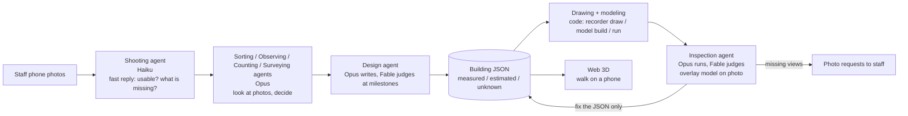

# {{PROJECT_NAME}} (working name: campus-recorder)

> DRAFT. `{{...}}` marks values to be filled in on the last day. Nothing in braces is a real value.

**Campus staff take photos with a phone. Claude agents measure the photos, design the building, assemble it in Blender, overlay the model on the photos to check it, and add it to a Web 3D that prospective students can walk on their phones.**
This is a way for a university to *record its campus and hand it over*, not a photo-analysis tool.

Video: {{VIDEO_URL}} · Japanese version: [README.ja.md](README.ja.md)

## Built during the hackathon

This is a submission for Built with Claude: Japan 2026 (2026-11-02 12:00 to 11-08 20:00 JST).
The repository was started on **2026-11-02** (first commit: 2026-11-02). All code, agent definitions, and docs in this repository were written during the event period.
Input photos taken before the period are used as input data, as allowed by the official Q&A (Q2, Q3). See "Data and sources".
`{{TBD}}`: confirm the Q&A wording before submission.

## Why

- **Prospective students** far from campus cannot afford the trip to open campus. 360-degree photo tours do not show distances between buildings, slopes, or the walk from the station.
- **University PR staff** want a walkable 3D campus but have no budget for a vendor and no 3D expert on staff.

How this differs from scanning or AI generation: **it records, it does not generate.**
- Every dimension is `measured` (with the ids of the photos it came from), `estimated` (the method and basis are written down), or `unknown` (value is null). A `measured` value with no evidence fails validation. Nothing is invented.
- The result sits on real map coordinates (JGD2011 / EPSG:6675), not in a free-floating scene.
- One JSON file per building is the only source of truth. Drawings, the Blender model, and the photo overlays are all generated from it. Fix the JSON and everything is rebuilt.
- Photos are never published. Only an index is kept in git.
- When photos are not enough, the system asks for more ("the library's north-east face needs one photo that shows both ends of the wall, from the bottom of the slope") instead of guessing.

## How it works



Principle: **the ruler is code, the surveyor is Claude.** Deterministic tools (`recorder`) rectify photos, find periodic patterns, and render. Judgement (which face is this, how many bays, which reference length to trust, what to fix) is made by Claude agents and written to JSON with its basis.

## How Claude is used

- **Claude Code is the center of development.** Almost all code, tests, and docs were written with Claude Code.
- **The agents are defined as files** in [`.claude/agents/`](.claude/agents/): eight agents plus a shared contract (`_共通.md`, "shared promises"). They run as Claude Code subagents now. The same definitions are designed to be moved to the Agent SDK (API) so staff can use them from a web screen. `{{TBD}}`: state exactly how far the SDK path works at submission.
- **Model roles** (see [`docs/逆算.md`](docs/逆算.md)):

| Role | Model | Job |
|---|---|---|
| Shooting agent (`satsuei`) | Haiku | Fast reply to staff |
| Sorting, observing, counting, surveying (`shiwake`, `kansatsu`, `kazoe`, `sokuryo`) | Opus | Look at photos and decide |
| Design (`sekkei`), inspection (`kenshu`) | Opus writes and runs; Fable judges at milestones | Write the building JSON; compare model and photos and fix the JSON |
| Drawing and model (`seizu`) | code | `recorder draw`, `model build` |
| Implementation | Opus for code that sees photos/JSON, Sonnet for clear specs | Tools |

- **Hand-made procedures became agent procedures.** On 11/3 the surveying of the first two buildings was done by hand with Claude; each step was then written down as the agents' procedure ([`docs/手順_エージェント.md`](docs/手順_エージェント.md), 12 steps, including the failures: picking photo corners by eye gave hundreds of px of error, so the viewpoint is now derived from the rectification).
- Every agent writes a JSON report with `made_by` (agent and model) and `made_at`.
- Usage is monitored with an explicit budget policy (`docs/逆算.md`).

## Results

Filled in on the last day:

| Buildings with evidence-backed models | Photos used | `measured` values | `estimated` values | `unknown` values | Photo requests issued |
|---|---|---|---|---|---|
| {{N_BUILDINGS}} | {{N_PHOTOS}} | {{N_MEASURED}} | {{N_ESTIMATED}} | {{N_UNKNOWN}} | {{N_REQUESTS}} |

## Setup and usage

Requirements: Python 3.13, Blender 5.2, network access for the first site build and for the viewer (three.js is loaded from jsdelivr).

```bash
python -m venv .venv
.venv/Scripts/pip install -e ".[dev]"
export BLENDER="<path to Blender 5.2 executable>"   # do not open .blend files by double click
```

Run everything as `python -I -X utf8 -m recorder <command>`:

| Command | What it does |
|---|---|
| `new <id> <name>` (`--from-site`) | Create an empty building JSON (or a base from PLATEAU and 5 m elevation) |
| `validate <json>` | Check the evidence rules |
| `draw <json>` | Elevation and plan SVGs; unknowns shown in red |
| `unknowns <json>` | List unknown values (feeds photo requests) |
| `model build <json>` | Blender model, four views, bird's-eye, glb (`--cameras` for photo viewpoints) |
| `run <json>` | validate, draw, model, overlay, and `run_report.json` in one go |
| `site build` / `site export-web` / `site confirm` | Site base from public data; export for the viewer; record staff confirmation |
| `photos import` | Read EXIF, add to the index (`--period before` or `during`) |
| `photos rectify` / `measure` / `stitch` | Straighten a wall; count bay and floor pitch; join two one-sided photos |
| `photos compare` / `pose` / `overlay` | Inspection: line-by-line offsets in m; recover the camera; overlay model on the photo |

Walk the campus (see [`web/README.md`](web/README.md)):
```bash
python -I -X utf8 -m recorder site export-web
cd web && python -m http.server 8000     # open http://localhost:8000/
```
PC: WASD and drag. Phone: left stick to move, drag to look. Colored buildings have evidence; gray boxes are unmeasured PLATEAU shapes.

Tests: `python -I -X utf8 -m pytest` (test files are in `tests/`).

## Data and sources

- **Photos taken by the author.**
  - During the period: 2026-11-03, 124 photos (index field `period: "during"`).
  - Before the period: 2026-09-07 to 2026-10-12, 723 photos (`period: "before"`), brought in as **input data** under the official Q&A (Q2, Q3).
  - The photos themselves are **not in this repository** (not published; faces and license plates are kept out). Only the index JSON is committed. Evidence in building JSON points to photo ids, so the `period` is always traceable.
- **A personal classification ledger made before the period** (which photo shows which building) was used as input to the tool-building. It is data, not code. Values from it are marked `source: "台帳(期間前)"`.
- **PLATEAU** (MLIT Japan, Nagoya 2022): building footprints and heights, used only as a base and overwritten by photo evidence.
- **OpenStreetMap** (roads, boundaries, building names). `{{TBD}}`: attribution text (ODbL).
- **Geospatial Information Authority of Japan**: aerial photos and 5 m elevation (attribution shown).
- **CC0 assets** for sky/lighting/materials. `{{TBD}}`: list the actual assets when used.
- **CC0 assets (Poly Haven / Kenney)**: the full list (source URL, license, SHA256) is in `data/assets/catalog.json`. Only CC0-1.0 is accepted (no CC-BY). They supply only the look; position, count and size come from the evidence-backed values in the building JSON. Files are fetched with `python -m recorder assets fetch` into `assets/` (not in the repository).
- The official campus map was used only to confirm building names and existence, within the university's permission. No shapes, positions, or dimensions were traced. It is not in the repository (`data/reference/` is git-ignored).

**Not used**: anything derived from Google (maps, aerial photos, 3D, Street View); tracing of any campus plan or web drawing; any previously finished model. Earlier project folders were read-only references; no code, model, or measurement was copied.

## Honest limits

- Many values are `estimated` (visual judgement with the method written down), not surveyed. Only dimensions with a measurable basis are `measured`.
- Buildings with many `unknown` values stay gray boxes with photo requests. Some details are provisional: tower 75's upper corner setbacks, recess depth, podium shape, and bridge height are not measured.
- Of the main building, only one face is cross-checked with three photos; other faces are visual estimates.
- No collision detection in the viewer. No trees yet. Materials and lighting are a first pass.
- Inspection works only for faces that could be rectified; oblique-only faces need rectification first.
- Tool bugs found during use are kept in `docs/日誌.md`. `{{TBD}}`: final known-issues list.
- The staff upload screen and the Agent SDK path are `{{TBD}}`: describe the state at submission.

## Acknowledgements

Meijo University (its public relations office) granted permission (2026-11-04) to trace the official campus maps and to publish photos taken on campus, on the condition that nothing related to research or laboratories is photographed. We also thank the faculty member who relayed the request. In this work the maps are used only to confirm building names and rough positions; shapes and dimensions come from photos, PLATEAU and OSM. See `data/reference/index.json`.

## License

`{{LICENSE_TBD}}`: code under MIT (tentative; the author decides). Data and images (building JSON, models, drawings, photos) are not for reuse (tentative). The `LICENSE` file currently contains MIT.

## Work log

Time per step is recorded in [`docs/日誌.md`](docs/日誌.md).
