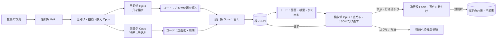

# 審査員の Claude になり切って読んだ記録と README の書き直し案（11/6）

想定：審査員は時間が無く、提出リポジトリを Claude に読ませて要約と採点をさせる。
この文書は「その Claude」が初見の 10 分で何を受け取り、何を取りこぼすかの記録と、README の書き直し案。
README そのものは変えていない（反映は利用者）。数字は 2026-11-06 夕方の作業ツリー（未コミットの `recorder/serve.py` など込み）で数えた。

---

## 1. README だけを読んだ時点の要約（他は読んでいない状態で 10 行）

1. **何か**：大学職員がスマホで撮った写真から、Claude のエージェント群が建物の寸法を測り、棟ごとの JSON（設計図）→ Blender 模型 → 写真との重ね合わせ検収 → 受験生がスマホで歩ける Web 3D、までを作る「キャンパスの記録と引き継ぎ」の仕組み。
2. **新しさ**：生成ではなく記録。全寸法が measured（写真 id 付き）/ estimated（方法付き）/ unknown（null）のどれかで、根拠の無い measured は検証で落ちる。足りなければ推測せず撮影依頼を出す。
3. **新しさ 2**：「定規はコード、測量士は Claude」。正面化・周期検出・描画はコード、判断（どの面か・何スパンか・どの物差しを信じるか）はエージェントが根拠付きで JSON に書く。
4. **Claude の使い方**：`.claude/agents/` に係を定義（「8 本」と書いてある）。Haiku / Opus / Fable の役割分担表あり。11/3 の手作業を 12 手順の手順書にした。
5. **出来ている物（と読める）**：CLI（new/validate/draw/model/run/site/photos …）、歩く画面（web/）、実験 9 本の結果表（数字付き、失敗も残す）。
6. **出来ていない物**：成果の表（棟数・写真枚数・measured 件数 …）が全部 `{{…}}` で空。動画も空。職員のアップロード画面と Agent SDK 版は `{{TBD}}`。
7. **正直な限界**：estimated が多い、本部棟で 3 枚の突き合わせが済んだのは 1 面だけ、木・衝突判定なし。
8. **データの出所**：期間中の写真 124 枚・期間前 723 枚（Q&A Q2・Q3 で入力扱い）、PLATEAU・OSM・国土地理院、CC0。Google 由来は不使用、公式図は名称確認のみ。写真はリポジトリに無い。
9. **証拠の場所**：`docs/実験_*.md` 6 本、`docs/手順_エージェント.md`、`docs/日誌.md`、`out/experiments/*.json`（ただし「コミットしていない」と書いてある）。
10. **10 分の印象**：実験表は濃くて信頼できるが、**完成した物の姿（絵 1 枚・数字 1 つ）が README に無い**。成果の表が空なので、採点者の Claude は「動く物がどこまであるか」を判断できず、「実験は多いが成果は未定」と要約しがち。

### README だけで伝わらない・誤解される点
- **絵が 1 枚も無い。** README に画像が無く、しかも `git ls-files` で画像（png/jpg/svg）は 0 件（`out/` も `web/data/` も git 管理外）。審査員の Claude はリポジトリから成果の見た目を一切確かめられない。
- **成果の数字が空**（`{{N_*}}`）。今すぐ埋められる値がある（3 節）。
- **係の数が「8 本」だが、実際は 12 本＋共通**（`chizu` `kansatsu` `kazoe` `kenshu` `mejirushi` `satsuei` `seizu` `sekkei` `shikichi` `shinko` `shiwake` `sokuryo`）。表にも mermaid にも 目印係・進行役・敷地の検収係・地図探し係 が無い。実験表で突然 `mejirushi` が出てくる。
- **Fable の役が古い**：README は「設計・検収を Fable が節目で判断」。11/5 の決定（手順書「進行役と事件」）では Fable は**事件の時だけ呼ばれる進行役 `shinko`**。しかも API 版（`recorder/agents.py`）は fable を opus に落とす。
- **期間中の写真枚数が古い**：README は 2026-11-03 の 124 枚。索引では期間中 340 枚（11/3 124・11/4 16・11/5 200）。
- **CC0 の行が 2 つ**あり、1 つは `{{TBD}}` のまま古い。もう 1 つは「Poly Haven / Kenney」だが台帳 13 件は全部 Poly Haven（Kenney は自動取得できず未使用、`not_found` に記録）。
- **棟 JSON は手書きではなく `scripts/design_<id>.py` が書く**（設計係はスクリプトを書き、検収係も直すのはスクリプトだけ）。README の「元データは JSON 1 つ」と一見食い違うので、1 行の説明が要る。
- **Agent SDK 版の実情**：手順書には「まだ本物のキーでは試していない（dry-run と SDK のモック試験まで）」とある。README の `{{TBD}}` はこの事実で埋まる（11/7 に試すなら更新）。
- **コマンド表に無い主要コマンド**：`report`（進捗報告）、`evidence`（証拠ビューア）、`serve`（職員の画面の受付）、`agent list/run/pipeline/events/decide`、`campus init/check`、`photos landmarks/pnp`。
- **measured の少なさの説明が無い**：数えると measured 18・estimated 2,348・unknown 43。タワー75 だけで estimated 2,010（窓などの部品を 1 つずつ数えるため）。説明なしに出すと「ほぼ推定」と読まれる。逆に、正直に出して「measured は 2 つ目の物差しで検算できた物だけ」と言い切るのが作品の主張に合う。`report.json` でも「実測で形が決まった面 0」（本部棟・タワー75 とも）なので、ここは言葉を選ぶ必要がある。

---

## 2. README からのリンクを辿った結果

### 辿れた物と、そこで伝わること
| リンク先 | 伝わること | 審査員の Claude にとっての難点 |
|---|---|---|
| `docs/手順_エージェント.md`（422 行） | 係の表（12 係・道具・モデル）、1 面を通す手順、進行役と事件、置く係／止める係（GAN の考え）、職員の画面と `serve` の API、API 版の形、進捗報告の 6 段 | 最も大事な文書だが**長く、日付ごとの追記の積み重ね**。冒頭の係の表は良いが、README の表と係の数・Fable の役が食い違う。読み手は「どちらが今か」で迷う |
| `docs/日誌.md`（106 行） | 工程ごとの時間、並列で何本の Opus を回したか、失敗と取り下げ | 1 行が非常に長い。合計時間、人の時間と Claude の時間の内訳が無い |
| `docs/実験_*.md`（6 本） | それぞれ問い・方法・数字・結論 | 良い。README の表と 1 対 1 で対応していて読みやすい |
| `docs/逆算.md` | 採点基準からの逆算、節目、使用量の方針 | 「11/4 夜（今）係の定義 8 本」など古い記述が残る（README の「8 本」の出所はここ） |
| `web/README.md` | 歩く画面の起動 | `web/data/` が git 管理外なので、`site export-web`（PLATEAU の zip・OSM・国土地理院の取得）を先に通さないと開けない。審査員が手元で歩くのはほぼ無理 |

### README に無くて辿れなかった大事な物
| 物 | 場所 | なぜ大事か |
|---|---|---|
| 進捗報告（棟ごと 1 ページ：写真 → 根拠の色付き立面図 → 証拠 → 模型 → 歩ける 3D → まだ無い物） | `recorder report` → `out/honbu/report.html`・`out/tower75/report.html`（git 管理外） | 作品の「完成形の見せ方」そのもの。README の Results の骨格にそのまま使える |
| 進捗の 1 行の結果 | `out/<棟>/report.json` の `stages`（例：本部棟「登録済みの写真 18 枚、目印の対応 6 点、再投影の中央値 22.4 px」） | 成果の表の数字の出所になる |
| 職員の画面と受付サーバ | `web/staff.html`、`recorder serve`（未コミット）、API 5 本 | 「職員がキャンパスを記録して引き継ぐ」の入り口。README の限界欄では `{{TBD}}` |
| 証拠ビューア | `recorder evidence` → `out/<棟>/evidence.rrd`・`evidence_*.png` | 実験表の 1 行にあるだけ。「立面図を信じてよい理由」を見せる中心の絵 |
| 係の定義の中身 | `.claude/agents/*.md`（12＋`_共通.md`） | リンクはあるが、何本・誰が何を決めるかの一覧が README の表と合っていない |
| 決定の台帳 | `data/decisions.json`（D-0001〜0003、`by: shinko(fable)`、理由付き） | 「進行役が決めて規則にする」が実際に動いた証拠 |
| 争点 | `out/<棟>/soten.json`（事件の検出は `recorder/agents.py`）。**今は実ファイル 0 件** | 置く係と止める係の分離の要。実例が無いことを README で正直に言うか、11/7 に 1 件出す |
| 事件の検出結果 | `out/honbu/events.json`、`recorder agent events` | 進行役が「いつ呼ばれるか」が機械的に決まる証拠 |
| 棟 JSON の形 | `data/buildings/*.json`（4 棟）、`recorder/schema.py`、書く側 `scripts/design_*.py` | 3 状態の実物の例が README に無い（下の 4 節に 1 例） |
| 物差し台帳・語彙・敷地 JSON | `data/rulers.json`、`data/vocab.json`、`data/site/tempaku.json` | 「縮尺の根拠を選ぶ」「大学名をコードに書かない」の実体 |
| 写真の索引と登録台帳 | `data/photos/index.json`（1,063 枚、`period` 付き）、`data/photos/registry.json`（登録 35 枚、未登録 173 件と理由） | 期間前／期間中の区別と、登録できなかった写真の記録 |
| 試走の記録 | `docs/試走_本部棟_11-04.md`・`_記録.json` | 「写真だけで歩く画面まで、人の手を挟まず」の唯一の通し試験（約 1 時間 30 分、Opus 8 本、手順書の穴 18） |
| 検算の記録 | `docs/検算の記録_本部棟.md` | measured の 2 つ目の物差し |
| 撮影ガイド | `docs/撮影ガイド.md` | 職員向けの入口 |
| CC0 アセット台帳 | `data/assets/catalog.json`（13 件、全部 Poly Haven、CC0-1.0、`not_found` 5 件） | Data and sources で言及はあるがリンクが無い |
| 大学の許可の記録 | `data/reference/index.json` | 謝辞に名前だけ |

---

## 3. `{{…}}` の穴と、今埋められる値

| 穴 | 場所（英・日とも） | 提案する値 | 出所 |
|---|---|---|---|
| `{{PROJECT_NAME}}` | 1 行目 | **利用者が決める**（仮名 campus-recorder のままでも可） | — |
| `{{VIDEO_URL}}` | 冒頭 | **利用者が決める**（動画の公開後） | — |
| `{{TBD}}` Q&A の文言 | 「期間中に作った物」 | **利用者が確認**。今の書き方（Q2「開始前に自分で作ったデータは入力に使える」、Q3「持ち込みデータは README に明記」）は CLAUDE.md の要約と一致 | CLAUDE.md 規約 3 |
| `{{TBD}}` SDK 側の到達点 | Claude の使い方 | 「`recorder agent run/pipeline` で同じ定義を Agent SDK で回す形まで実装。本物の API キーではまだ試しておらず、dry-run と SDK をモックした試験まで」（11/7 に本番を試したら結果に差し替え） | 手順書「API で動かす」 |
| `{{N_BUILDINGS}}` | 成果の表 | **4 棟**に棟 JSON（本部棟・タワー75・図書館・11 号館）。うち歩く画面で色付き 3、ほかは PLATEAU の灰色の箱 76 | `data/buildings/`、`report.json` の walk |
| `{{N_PHOTOS}}` | 成果の表 | 索引 **1,063 枚**（期間前 723・期間中 340）、棟の決まった物 412 枚、カメラ位置まで解けた（登録）物 **35 枚**（本部棟 18・タワー75 17）。「使った枚数」の定義を 1 つに決めること | `data/photos/index.json`、`registry.json` |
| `{{N_MEASURED}}` | 成果の表 | **18**（図書館 9・本部棟 8・タワー75 1・11 号館 0） | 棟 JSON の `status` を全部数えた |
| `{{N_ESTIMATED}}` | 成果の表 | **2,348**（タワー75 2,010・本部棟 290・図書館 31・11 号館 17）。部品ごとに数えるので多い、と注記必須 | 同上 |
| `{{N_UNKNOWN}}` | 成果の表 | **43**（本部棟 25・図書館 12・タワー75 5・11 号館 1） | 同上 |
| `{{N_REQUESTS}}` | 成果の表 | open **75 件**（本部棟 30・タワー75 24・図書館 14・11 号館 7）、done 4 件。種類：撮影 51・道具 14・データ 5・確認 5 | 棟 JSON の `requests` |
| `{{TBD}}` OSM の帰属表示 | Data and sources | `© OpenStreetMap contributors, available under the Open Database License (ODbL 1.0)`（日本語版は「© OpenStreetMap contributors（ODbL 1.0）」） | OSM の標準の表記 |
| `{{TBD}}` CC0 の列挙 | Data and sources | 古い行を消し、台帳の 13 件を書く：質感 4（brick_ochre・concrete_dark・asphalt・paving_block）、HDRI 1（hdri_overcast）、置物 8（ac_outdoor・street_lamp・bench・tree_small・table_long・table_office・chair_stack・chair_school）。全部 Poly Haven・CC0-1.0。Kenney は未使用 | `data/assets/catalog.json` |
| `{{TBD}}` 既知の問題 | 正直な限界 | 候補：立面図の右の注記が 1066 px の外で切れる／タワー75 で上端だけの目印ではカメラの高さが決まらない／本部棟 E 面の模型の穴 2 件／一括復元は反対側の面を取り違える／`soten.json` の実例がまだ無い／内装は 11/6 に一旦停止。最終の一覧は **利用者が決める** | 手順書、実験の文書、日誌 |
| `{{TBD}}` 職員の画面と SDK | 正直な限界 | 「`web/staff.html`＋`recorder serve`（127.0.0.1 で待つ受付、API 5 本）。写真の受け取り → 取り込み → 振り分け → 棟ごとに pipeline 起動まで実装・テスト済み。API キーが無ければ dry-run」 | 手順書「職員の画面」 |
| `{{LICENSE_TBD}}` | License | **利用者が決める**（今の `LICENSE` は MIT） | — |

### 穴ではないが、今の値で直すべき所
| 所 | 今 | 直す値 |
|---|---|---|
| 係の数 | eight agents / 係 8 本 | 12 本＋共通の約束 |
| 期間中の写真 | 2026-11-03、124 枚 | 2026-11-03〜05、340 枚（11/3 124・11/4 16・11/5 200） |
| Fable の役 | 設計・検収を節目で判断 | 事件の時だけ呼ばれる進行役（`shinko`） |
| CC0 | 2 行（1 行は TBD、もう 1 行は Poly Haven / Kenney） | 1 行にまとめ、Poly Haven のみ |
| `seizu` のモデル | 表では「コード」 | 定義の frontmatter は `model: sonnet`（コマンドを打つだけの係）。表は「コード（係は Sonnet がコマンドを打つだけ）」 |

### README に足すとよい数字（今の値）
- テスト **375 件**（`pytest --co -q`。未コミットの `tests/test_serve.py` 込み）
- コミット **76**（11/2 2・11/3 4・11/4 44・11/5 12・11/6 14）、最初のコミット 2026-11-02 23:47 JST
- 係 **12 本**＋共通、決定の台帳 **3 件**、CLI のコマンド 約 50
- 登録の精度：正解付き 17 枚で位置の誤差 中央値 0.7 m（実験）、本番の再投影 中央値 本部棟 22.4 px・タワー75 16.4 px（`report.json`）

---

## 4. README の書き直し案

### 方針
- 審査員の Claude は**最初の 30 行で要約を作る**。そこに「何を・誰が・入力・出力・証拠」と**数字**を置く。
- **絵を最低 4 枚コミットする**（今は 0 枚）。`docs/img/` に生成物の写しを置く案：根拠の色付き立面図（`out/honbu/elev_SW.svg`）、証拠ビューア（`evidence_three.png`）、模型と写真の重ね（`overlay_*.png`、顔・ナンバーが無い物）、歩く画面（`out/web_look_after_honbu_pc.png`）、職員の画面（`out/staff_pc.png`）。写真が写る絵は規約 6（顔・ナンバー）と規約 4（研究室・掲示物）を目で確かめてから。**生成物を手で直さず写すだけ**（生成コマンドを添える）。規約の「out/ は git 管理外」との兼ね合いは利用者が決める。
- 長い経緯は文書へ、README は「今の姿」だけ。係の表は 1 つ（手順書の表と同じ物）にする。
- 「試した事と結果」の表はそのまま残す（作品の主張「決めつけない」の証拠）。

### 節の順
1. タイトル＋**Key facts（5 行）**＋絵 1 枚（進捗報告の縦長の絵か、写真 → 立面図 → 歩く画面の 3 枚並び）
2. 期間中に作った物／持ち込んだ物（短く。詳細は「データと出典」）
3. 何が新しいか（生成ではなく記録。3 状態。撮影依頼）＋棟 JSON の 1 値の実例
4. 結果（数字の表＋棟ごとの 1 行＋絵 3〜4 枚）
5. Claude の使い方（30 秒で分かる形）
6. 仕組み（mermaid を 12 係に合わせて直す）
7. 試した事と結果（今の表をそのまま）
8. 証拠の確かめ方（どのファイルを見れば何が確かめられるか）
9. セットアップと使い方（コマンド表に report・evidence・serve・agent・campus を足す）
10. データと出典
11. 正直な限界
12. 謝辞・ライセンス・日誌

### 4-1. 各節の下書き（英語）

````markdown
# {{PROJECT_NAME}} — campus-recorder

**Key facts**
- **What**: turns campus staff's phone photos into evidence-backed building drawings, Blender models, and a Web 3D campus that prospective students can walk on a phone.
- **Who**: Claude agents decide (12 roles in `.claude/agents/`), deterministic code measures and renders (`recorder/`), people only take photos and look at the results.
- **Input**: 1,063 photos taken by the author (340 during the event; 723 before it, used as input data per official Q&A Q2/Q3), PLATEAU, OpenStreetMap, GSI elevation and aerial photos, CC0 assets. Nothing from Google.
- **Output**: one JSON per building (4 buildings) where every value is `measured` (photo ids), `estimated` (method written), or `unknown` (null + a photo request); drawings, models and the walk view are generated from it.
- **Evidence**: `data/buildings/*.json`, `data/photos/registry.json` (35 photos with solved cameras), `data/decisions.json`, `docs/実験_*.md` (9 experiments, failures included), `docs/日誌.md` (time per step), 375 tests.


## Built during the event
Built with Claude: Japan 2026 (2026-11-02 12:00 – 11-08 20:00 JST). First commit 2026-11-02 23:47 JST. All code, agent definitions and docs were written during the event.
Photos taken before the event (2026-09-07 – 10-12) and the author's own classification ledger are used **as input data only**, as allowed by the official Q&A (Q2: data you made before the event may be used as input; Q3: brought-in data must be stated in the README). Every photo carries `period: "before"` or `"during"`, so the "before" photos can be excluded and the pipeline re-run.

## What is new: it records, it does not generate
- Every value in a building JSON is in one of three states. `measured` needs photo ids and a check by a second ruler; `estimated` needs the method; `unknown` is null. Validation rejects a `measured` value without evidence.
- When photos are not enough, the system asks instead of guessing: "the library's f0 needs one photo from the east corridor with both ends of the wall."
- Real map coordinates (JGD2011 / EPSG:6675). Fix the JSON, and drawings, model and walk view are rebuilt.
- Photos are never published. Only the index is in git.

One real value (library, `floor_count`):
```json
{"value": 5, "unit": "階", "status": "measured",
 "evidence": ["PXL_20261103_075437320", "PXL_20261103_075438398", "…"],
 "method": "1 row of small top windows + 3 rows of wide windows + 1 windowless base = 5; agrees in 4 rectified/stitched views"}
```
(`building JSON` is written by `scripts/design_<id>.py`, which the design agent writes and the inspection agent edits; nobody edits the JSON or the drawings by hand.)

## Results (as of 2026-11-0X)
| Building JSONs | Colored in the walk view | Photos indexed (during / before) | Photos with solved camera | measured | estimated | unknown | Open requests to staff |
|---|---|---|---|---|---|---|---|
| 4 | 3 (76 gray PLATEAU boxes) | 1,063 (340 / 723) | 35 | 18 | 2,348 | 43 | 75 (51 photo, 14 tool, 5 data, 5 check) |

Why so few `measured`: a value is `measured` only when the scale was checked with a second, independent ruler (e.g. bay width vs. floor height). Everything else that is visible is placed as `estimated`, with its method (tower 75 alone has 2,010, because each window and band is a separate value). We prefer an honest yellow to a false green.

## How Claude is used (30-second version)
**Claude decides, code measures, people only look.**

| Who | Does | Never does |
|---|---|---|
| Staff (people) | take photos, answer photo requests, look at the report | draw, model, or type dimensions |
| Claude agents | decide which face, how many bays, which ruler to trust, what to place, what to fix, when to stop | compute pixels or render |
| Code (`recorder`) | rectify, find periods, solve camera poses (PnP), render drawings / models / walk view | make judgements |

The 12 agents (definitions in `.claude/agents/`, shared rules in `_共通.md`):

| Step | Agent | Model | Decides |
|---|---|---|---|
| 1 | Shooting `satsuei` | Haiku | Is this photo usable? What is missing? (seconds) |
| 2 | Sorting `shiwake` | Opus | Which building and which face (GPS is only a hint) |
| 3 | Observing `kansatsu` | Opus | What is on each face, as ratios and counts only |
| 4 | Counting `kazoe` | Opus | Number of bays and floors, cross-checked over photos |
| 5 | Landmarks `mejirushi` | Opus | Which grid cell shows which model corner; code solves the camera |
| 6 | Surveying `sokuryo` | Opus | Which ruler sets the scale, checked by a second ruler |
| 7 | Design `sekkei` | Opus | Writes the building JSON: places everything ≥ 1 m that is visible |
| 8 | Drawing `seizu` | code (Sonnet only types the command) | nothing |
| 9 | Inspection `kenshu` | Opus | Overlays model on photos, fixes only the JSON, may stop the designer for 5 fixed reasons |
| 10 | Site inspection `shikichi` | Opus | Conflicts between buildings and terrain |
| — | Map finder `chizu` | Haiku | Official map URL and building names (names only) |
| — | Facilitator `shinko` | Fable | Called **only on incidents** (setup, stuck, vocabulary, asset, done, human); turns each decision into a rule (`data/decisions.json`) |

- Placing and stopping are split between two agents (design vs. inspection), borrowed from the GAN idea: a single agent told both "place what you see" and "never guess" placed only one gutter in the 11/4 trial.
- The procedure (`docs/手順_エージェント.md`) was written by doing two buildings by hand with Claude on 11/3, then turning every step, failures included, into agent rules.
- During development Claude Code ran these as subagents, usually 3–5 Opus agents in parallel; the time for each step is in `docs/日誌.md`. The same definitions run through the Claude Agent SDK (`recorder agent pipeline`): {{state at submission}}.

## Where to check the evidence
| Claim | Look at |
|---|---|
| No value without a basis | `data/buildings/*.json`, `recorder validate` |
| Photos are placed, not guessed | `data/photos/registry.json` (35 registered; 173 not registered, each with a reason) |
| Decisions become rules | `data/decisions.json`, `docs/手順_エージェント.md` |
| Before / during photos are separable | `data/photos/index.json` (`period`) |
| Time and failures | `docs/日誌.md`, `docs/試走_本部棟_11-04.md` |

## Data and sources
- Photos by the author: 340 during the event (11/3–11/5), 723 before it (9/7–10/12), the latter used as input data (Q&A Q2, Q3). **Not in the repository**; only the index. Photos showing faces, licence plates, labs or posters are kept out.
- PLATEAU (MLIT, Nagoya 2022): base footprints and heights only, overwritten by photo evidence.
- © OpenStreetMap contributors (ODbL 1.0): roads, boundaries, names, ground cover.
- GSI Japan: aerial photos and 5 m elevation.
- CC0 assets only (13 items from Poly Haven, CC0-1.0; list in `data/assets/catalog.json`). No CC-BY. Assets give the look; position, count and size come from the building JSON. Not in git; `recorder assets fetch`.
- Official campus map: used **only to confirm building names and existence**, although the university allowed tracing. No shapes or dimensions traced; not in git.
- **Not used**: anything from Google (maps, aerial photos, 3D, Street View); tracing of plans or web drawings; earlier finished models.
````

### 4-2. 各節の下書き（日本語。平易に）

````markdown
# {{PROJECT_NAME}}（campus-recorder）

**ひと目で**
- **何を**：職員のスマホの写真から、根拠つきの建物の図面・Blender の模型・受験生がスマホで歩ける Web 3D のキャンパスを作ります。
- **誰が**：決めるのは Claude のエージェント（係 12 本、`.claude/agents/`）、測って描くのはコード（`recorder/`）、人は撮って結果を見るだけ。
- **入力**：作者が撮った写真 1,063 枚（期間中 340 枚・期間前 723 枚。期間前の分は公式 Q&A Q2・Q3 に基づく「入力データ」）、PLATEAU、OpenStreetMap、国土地理院の標高と航空写真、CC0 の素材。Google 由来の物は使っていません。
- **出力**：棟ごとの JSON（4 棟）。値は全部「測った（写真番号つき）」「推定（やり方を書く）」「不明（空＋撮影依頼）」のどれか。図面・模型・歩ける画面はここから自動で作ります。
- **証拠**：`data/buildings/*.json`、`data/photos/registry.json`（カメラの位置まで解けた写真 35 枚）、`data/decisions.json`、`docs/実験_*.md`（失敗も含め 9 件）、`docs/日誌.md`（工程ごとの時間）、テスト 375 件。

## 期間中に作った物と、持ち込んだ物
Built with Claude: Japan 2026（2026-11-02 12:00 〜 11-08 20:00 JST）の提出物です。最初のコミットは 2026-11-02 23:47。コード・係の定義・文書はすべて期間中に書きました。
期間前（2026-09-07〜10-12）に作者が撮った写真と、その分類の台帳は、**入力データとしてだけ**使っています（公式 Q&A：Q2「開始前に自分で作ったデータは入力に使える」、Q3「持ち込みデータは README に明記」）。写真には全部 `period`（before／during）が付いているので、期間前の分を外して作り直すこともできます。

## 何が新しいか：作るのではなく、記録する
- 棟 JSON の値は 3 つの状態のどれかです。「測った（measured）」は写真番号と、別の物差しでの検算が要ります。「推定（estimated）」はやり方を書きます。「不明（unknown）」は空のままです。根拠の無い「測った」は検証で落ちます。
- 写真が足りないときは、推測せずに頼みます（「図書館の東の面は、両端が入る 1 枚を東の廊下からください」）。
- 実際の地図の座標（JGD2011 / EPSG:6675）に乗ります。JSON を直せば、図面も模型も歩ける画面も作り直されます。
- 写真は公開しません。git には写真の一覧（索引）だけを入れます。
- 棟 JSON は人が手で書くのではなく、設計係が書いた `scripts/design_<棟>.py` が出力します。検収係が直すのもこのスクリプトだけ。図面や模型を手で直すことはありません。

## 結果（2026-11-0X 時点）
（英語版と同じ表）
「測った」が少ない理由：縮尺を 2 つ目の物差し（例：柱の間隔と階の高さ）で確かめられた値だけを「測った」にしているからです。見えている物は「推定」として、やり方を書いて置きます（タワー75 は窓や帯を 1 つずつ数えるので 2,010 件）。嘘の緑より、正直な黄色を選んでいます。

## Claude の使い方（30 秒で）
**決めるのは Claude、測るのはコード、人は結果を見るだけ。**

| 誰 | すること | しないこと |
|---|---|---|
| 職員（人） | 写真を撮る、撮影依頼に応える、報告を見る | 図面を描く、模型を作る、寸法を打つ |
| Claude の係 | どの面か・柱の間がいくつか・どの物差しを信じるか・何を置くか・どこを直すか・いつ止めるかを決める | 画素の計算、描画 |
| コード（`recorder`） | 写真をまっすぐにする、繰り返しを数える、カメラの位置を解く、図面・模型・歩ける画面を描く | 判断 |

係 12 本（定義は `.claude/agents/`、全員の約束は `_共通.md`）：

| 順 | 係 | モデル | 決めること |
|---|---|---|---|
| 1 | 撮影係 `satsuei` | Haiku | この写真は使えるか、何が足りないか（数秒で返事） |
| 2 | 仕分け係 `shiwake` | Opus | どの棟のどの面か（GPS は目安、目で確定） |
| 3 | 観察係 `kansatsu` | Opus | 面に何があるか（比と個数だけ。寸法は書かない） |
| 4 | 数え係 `kazoe` | Opus | 柱の間の数と階の数（写真を突き合わせる） |
| 5 | 目印係 `mejirushi` | Opus | 写真のどの升に模型の角があるか（カメラの位置はコードが解く） |
| 6 | 測量係 `sokuryo` | Opus | どの物差しで縮尺を決めるか（2 つ目の物差しで検算） |
| 7 | 設計係 `sekkei` | Opus | 棟 JSON を書く（写っている 1 m 以上の物は全部置く） |
| 8 | 製図係 `seizu` | コード（Sonnet はコマンドを打つだけ） | 判断しない |
| 9 | 検収係 `kenshu` | Opus | 模型を写真に重ねて、JSON だけを直す。決まった 5 つの理由でだけ設計係を止める |
| 10 | 敷地の検収係 `shikichi` | Opus | 棟どうし・棟と地形の食い違い |
| — | 地図探し係 `chizu` | Haiku | 公式地図の URL と棟の名前（名前だけ） |
| — | 進行役 `shinko` | Fable | **事件の時だけ**呼ばれる（立ち上げ・行き詰まり・語彙・アセット・完成判定・人を呼ぶ）。決めた事を規則にして台帳（`data/decisions.json`）と手順書に足す |

- 「置く係」と「止める係」を分けました（GAN の考え方）。1 つの係に「見えた物は置け」と「決めつけるな」を同時に教えたら、11/4 の試走で部品が雨どい 1 本になったからです。
- 手順書（`docs/手順_エージェント.md`）は、11/3 に 2 棟を Claude と手で測り、失敗も含めて一歩ずつ係の決まりにした物です。
- 開発中は Claude Code のサブエージェントとして、たいてい Opus を 3〜5 本並べて回しました。工程ごとの時間は `docs/日誌.md`。同じ定義を Claude Agent SDK で回す道（`recorder agent pipeline`）は {{提出時点の状態}}。

## 証拠の確かめ方
| 言っている事 | 見る所 |
|---|---|
| 根拠の無い値は無い | `data/buildings/*.json`、`recorder validate` |
| 写真の位置は当て推量でなく解いている | `data/photos/registry.json`（登録 35 枚、登録できなかった 173 件は理由つき） |
| 決めた事は規則になる | `data/decisions.json`、`docs/手順_エージェント.md` |
| 期間前と期間中の写真を分けられる | `data/photos/index.json`（`period`） |
| 時間と失敗 | `docs/日誌.md`、`docs/試走_本部棟_11-04.md` |

## データと出典
- 作者が撮った写真：期間中 340 枚（11/3〜11/5）、期間前 723 枚（9/7〜10/12。Q&A Q2・Q3 に基づく入力データ）。**写真はリポジトリに入れていません**（索引だけ）。顔・ナンバー・研究室・掲示物が写る物は外します。
- PLATEAU（国土交通省、名古屋市 2022）：土台の形と高さだけ。写真の根拠で上書きします。
- © OpenStreetMap contributors（ODbL 1.0）：道・境界・名前・地面の種類。
- 国土地理院：航空写真と 5 m の標高。
- CC0 の素材だけ（Poly Haven の 13 件、CC0-1.0。一覧は `data/assets/catalog.json`）。CC-BY も使いません。素材は「見た目」だけで、位置・個数・大きさは棟 JSON の値です。素材の本体は git に入れず、`recorder assets fetch` で取り直せます。
- 大学の公式キャンパス図：大学からはなぞる許可も頂いていますが、**棟の名前と有無の確認にだけ**使いました。形・寸法はなぞっていません。図はリポジトリに入れていません。
- **使っていない物**：Google 由来の物すべて（地図・航空写真・3D・ストリートビュー）、配置図やネットの図面をなぞること、過去に作った完成モデル。
````

### 4-3. 「仕組み」の mermaid の直し案

（`[[…]]` はコード、`[…]` は Claude。色分けできれば「判断＝Claude、計算＝コード」が絵で分かる）

---

## 5. 冒頭に置く 5 行の要約（Key facts）

英語：
```
- What: phone photos from campus staff → evidence-backed building JSON → drawings, Blender models, and a Web 3D campus students can walk on a phone.
- Who: 12 Claude agents decide (.claude/agents/), deterministic code measures and renders (recorder/), people only take photos and look.
- Input: 1,063 author-taken photos (340 during the event, 723 before it as input data per Q&A Q2/Q3), PLATEAU, OSM, GSI, CC0 assets; nothing from Google.
- Output: 4 building JSONs where every value is measured (photo ids) / estimated (method) / unknown (null + photo request): 18 / 2,348 / 43; 75 open requests.
- Evidence: data/buildings/, data/photos/registry.json (35 solved cameras), data/decisions.json, docs/実験_*.md (9 experiments incl. failures), docs/日誌.md, 375 tests.
```
日本語：
```
- 何を：職員のスマホ写真 → 根拠つきの棟 JSON → 図面・Blender 模型・受験生がスマホで歩ける Web 3D。
- 誰が：決めるのは Claude の係 12 本（.claude/agents/）、測って描くのはコード（recorder/）、人は撮って見るだけ。
- 入力：作者が撮った写真 1,063 枚（期間中 340・期間前 723 は Q&A Q2・Q3 の入力データ）、PLATEAU・OSM・国土地理院・CC0。Google 由来は不使用。
- 出力：棟 JSON 4 棟。全部の値が 測った（写真番号）／推定（やり方）／不明（空＋撮影依頼）のどれか：18／2,348／43、依頼 75 件。
- 証拠：data/buildings/、data/photos/registry.json（カメラが解けた写真 35 枚）、data/decisions.json、docs/実験_*.md（失敗込み 9 件）、docs/日誌.md、テスト 375 件。
```
※ 数字は 11/6 夕方。提出前に `recorder report` を全棟で出し直し、表と 5 行を同じ数字にそろえる。

---

## 6. 利用者が決めること（まとめ）
1. 作品名、動画 URL、ライセンス（コード MIT／データ再利用不可でよいか）、Q&A の文言の再確認。
2. 「使った写真」の数え方（索引 1,063／棟が決まった 412／カメラが解けた 35 のどれを表の主にするか）。
3. 絵をコミットするか（`docs/img/` に生成物の写しを数枚。今はリポジトリに画像が 0 枚で、審査員の Claude は見た目を確かめられない）。
4. 11/7 に API キーで pipeline を本番で回すか（回せば SDK の `{{TBD}}` が「動いた」に変わる）。
5. 争点 `soten.json` の実例を 1 件出すか、README で「仕組みはあるが実例はまだ」と書くか。
6. 「人は結果を見るだけ」の言い方：実際は人が撮影し、進行役の `human` 事件（撮影依頼・敷地の質問）に答え、11/6 に内装を止めるなどの判断もしている。「職員は撮って見るだけ。作者は方針だけ決めた」と分けて書くか。
7. 既知の問題の最終一覧。
